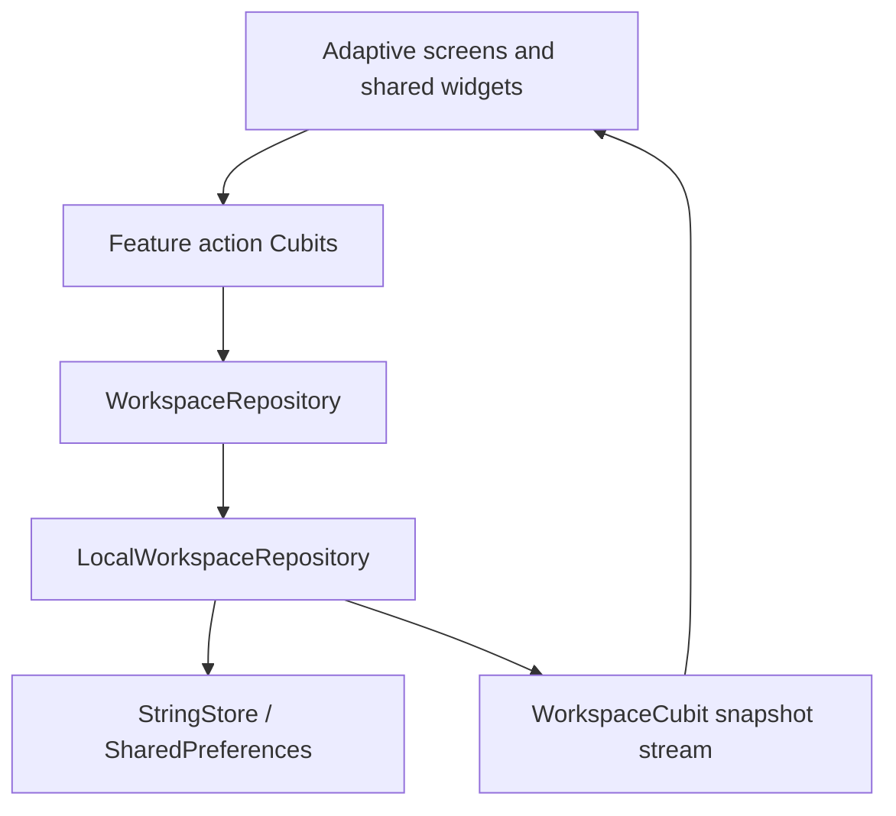

# NewCare

Arabic-first Flutter workspace for a nursing center, adapted for phones, tablets, desktop and square monitors.

Interface labels, hints, accessibility text and system messages are stored in Arabic and English ARB files. `localization_coverage_test.dart` checks referenced keys, enum labels, repository errors, ARB parity, exact runtime translations and hardcoded UI text. Route tests also reject the missing-translation fallback on rendered screens. User-entered names and notes remain record data.

## Run

```powershell
cd D:\Work\NewCare
flutter pub get
flutter gen-l10n
flutter run -d chrome
```

The app opens with illustrative local data. Initial manager preview password: `newcare-demo` (until changed in Settings).
The email field and password gate are UI previews; they are not production authentication.

## Implemented UI and local behavior

- Direct case registration without opening, joining or closing shifts. Historical shift records remain readable in storage for migration compatibility.
- Two desktop columns for inside/outside cases, with prominent centered headings; small screens switch between the forms using tabs.
- Inline registration forms, searchable multiple procedure names and a manually entered case total. Procedures have no price field in the catalogue or selection UI. Supplies are removed from new registration and catalogue screens; historical item snapshots are retained.
- Paid-at-registration amount, outstanding balance, subsequent cash/wallet receipts and a complete payment history. The outstanding-case filter searches all dates.
- Nursing can change a saved case price without changing existing receipts. Prices cannot fall below the amount already collected.
- Two outgoing categories: center outgoings and person outgoings. Person payments choose a purpose (advance, other payment or manager award) and a recipient (nursing staff or another person). Cash income stays separate. The UI has no standalone external-advance category.
- Drawer custody handover records sender, receiver, expected/count cash, difference and required mismatch notes. The next drawer holder receives the counted cash balance. Count differences stay separate from income and expenses.
- The large teal handover action sits below the outgoing card. The frontend excludes the sender from receiver choices, clears an invalid receiver when the sender changes and disables confirmation until two different people are selected. Login-based identity binding remains deferred.
- Financial reports and CSV include subsequent receipts by their actual payment dates. Wallet receipts do not increase physical drawer cash.
- Compact page headers without repeated logos, compact date/search controls, and dense readable case-book tables.
- Manager analytics, payroll, nursing cards, procedure catalogue, audit log, custom date ranges and direct edit/delete controls.
- Hero transitions for suitable record details, preserving source filters; reduced-motion settings are respected.
- Arabic RTL / English LTR, local Cairo Bold, reusable cards, tables, fields, dialogs and adaptive navigation.

The shared nursing device uses staff selection. Manager preview access is separate; production authentication and cloud synchronization are not implemented by this local preview.

## Structure



The current repository persists locally. Supabase production authentication and cloud synchronization remain separate work; the diagram describes the working local implementation.

Details open on a real Navigator page route through `NcDetailPage`, with a unique `NcHeroTitle` per source record. Selection controls and editing dialogs keep their existing interactions. Tests cover forward/back navigation, retained filters, reduced motion and opening details from the actual feature screens.

```text
lib/
  app/                       bootstrap, navigation, app Cubit and adaptive shell
  core/                      theme, localization, clock, storage, shared widgets
  features/
    <feature>/
      data/models/           serializable records and derived read models
      data/repositories/     repository contracts and adapters where needed
      presentation/cubit/    state transitions
      presentation/screens/  screen composition
      presentation/widgets/  focused reusable feature components
  l10n/                      Arabic/English ARB and generated localization
```

There is no entity, domain or use-case layer. Cubits depend on repository contracts through constructor injection. Local repository writes are serialized, published after durable storage, and audited. Money uses integer minor units.

## Verify and build

```powershell
flutter analyze
flutter test
flutter build web --release --no-web-resources-cdn
flutter build apk --debug
```

Visual captures use the Flutter renderer without browser access:
`flutter test --update-goldens tools/capture_previews_test.dart`.
The capture tool writes previews to this task's outputs directory and is outside the normal test suite.

Android uses `kotlin.incremental=false` because the local package cache and checkout are on different Windows drives. Windows native builds need Visual Studio C++ tools; iOS/macOS builds require macOS.

## Data and backend boundary

This phase is a working UI and local preview. Shared preferences persist sample records, but are not a production clinical database. Supabase Auth, database/RLS enforcement, multiple real manager accounts, encrypted offline storage, synchronization and conflict resolution remain backend work. No Supabase credentials or cloud project were configured. The visible save indicator means saved on this device; audit queue entries have not been uploaded.

Monthly salary is a stored base amount. The displayed remaining amount subtracts advances in the selected date period. Awards are already-paid cash outgoings and appear separately, so they are not added again to the salary balance. Salary payment receipts, attendance-based calculation, proration and payroll settlement are not implemented. Cash movements and drawer custody transfers operate independently of shifts.

Deleting nursing or procedures archives them to preserve historical attribution. Historical shift data is retained for backward compatibility, with no shift controls in the operational UI. Removing cases or cash movements recalculates current totals and stores the previous record in the local audit log.

## Design and repository

Figma: https://www.figma.com/design/OEygfKSLA6bHRDFb1cmVBE/NewCare
GitHub: https://github.com/Desha29/NewCare

The existing local `main` tracks `origin/main`. No assistant-generated commits were created. Current UI changes are intentionally left in the working tree for the user to commit.


## Accounting and troubleshooting

Case total is entered manually. Remaining balance equals the case total minus the initial receipt and subsequent receipts. A price correction cannot reduce the total below recorded receipts. Procedure selection supplies names only.

The physical drawer contains opening cash, cash case receipts, signed drawer movements and count differences from custody transfers. Wallet receipts stay outside physical cash. Drawer count differences are not income or expenses. See [architecture notes](docs/architecture.md).

Flutter web may report `Trying to render a disposed EngineFlutterView` during hot restart. This matches upstream reports [#175260](https://github.com/flutter/flutter/issues/175260) and [#182377](https://github.com/flutter/flutter/issues/182377). Refresh the browser tab; if necessary stop the development run and launch it again. No engine assertion is suppressed in this app.

If normal Git push fails in the Windows credential helper, the existing `tools/push-main.ps1` can publish user-created commits using the saved credential in memory. It never stages, creates commits or force pushes.

Outgoings use category helpers in records and transaction read models, so tables, search, charts and CSV share the same center/person classification. A generic person payment does not count as a nursing salary advance. Legacy advance records are displayed under person outgoings without rewriting their stored values.


## Preview devices and navigation

Run `flutter run -d chrome` in debug mode, then choose the devices icon in the workspace header. Device Preview 3 is installed through its binding before startup; a full restart is required after this integration. Its controls select phone, tablet, desktop or a 1024 × 1024 square monitor, simulate platform behavior, rotate, toggle the keyboard and change text scale. Reset returns to the real device. The package also supplies a Flutter DevTools extension. These controls and the preview binding are disabled in profile/release builds. Simulation checks layout; native platform builds still need testing on the corresponding devices.

The header menu hides/restores the sidebar on desktop and opens an explicitly closable drawer on phones. Case registration contains only the inside/outside forms; desktop cards fill the available page height and align their bottom actions. Short screens scroll without clipping fields. Draft form state survives responsive layout and sidebar changes. Compact forms pair amount fields and use available columns while preserving mobile touch targets.

The case book expands in the sidebar into Inside center and Outside center. Each destination shows only its own cases in one table using the full available content width. Phones and narrow tablet navigation also offer location chips. Date range, search, outstanding filters, details, price corrections and receipt collection remain available. The old case-book destination opens the inside ledger for compatibility.

Both case ledgers display the case's recorded payment method and its creation date/time in the center's timezone. Payment filtering combines with search, date range and outstanding balance. Outside cases show procedures alongside the address. Invoice, paid and outstanding columns use distinct colors; payment badges distinguish cash from wallet.

The drawer screen places outgoings on the right and live cash balance on the left in Arabic desktop layouts, with the custody handover button below the balance. On phones these sections stack. The balance is derived from workspace records and updates after cash case receipts, later cash receipts, outgoings and reconciliation adjustments. Wallet payments are excluded. The last count result is labeled separately from the current balance.

## Manager settings

Settings contains the manager profile, a password-change form and editable navigation names. Changing the preview password requires the current password, a matching confirmation and at least eight characters. A salted SHA-512 crypt hash is saved locally; the password itself is not stored. Once changed, the old preview password no longer unlocks the manager area and its hint is hidden. This is still a local preview gate, not production authentication.

Navigation names are saved per interface language and shared by sidebar, navigation rail, phone navigation and page header. Empty names use the translated default. Restore resets names for the current language; names are limited to 40 characters.
