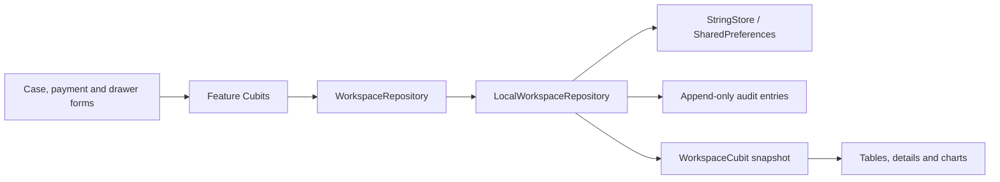

# Local workspace architecture

The application uses feature-first `data` and `presentation` modules with Cubit. Screens compose focused shared widgets; Cubits call the `WorkspaceRepository` contract. There are no entity, domain or use-case classes.

## Records and calculations

- `CaseRecord`: responsible nursing staff, procedure names, inside/outside location, required outside address, optional outside phone, manually entered total and the initial receipt.
- `CasePayment`: additional receipt with case reference, recorder, payment method, amount and actual collection timestamp.
- `CashMovement`: income or an outgoing. The UI groups outgoings as center/person; advances and awards are purposes within the person group. A named generic person payment remains an expense, while a nursing advance retains its payroll treatment. Legacy external-advance kinds are kept in storage and displayed as advances under person outgoings.
- `DrawerHandover`: sender, receiver, expected cash, counted cash, timestamp and discrepancy note. It transfers custody without creating a shift.

Amounts use integer minor units. Case outstanding balance is `invoice − initial payment − additional payments`. The repository rejects overpayment, a negative amount or a price correction below all receipts already collected.

Physical cash is `opening + cash receipts + signed cash movements + count adjustments`. Wallet receipts never change physical cash. Custody discrepancies are separate reconciliation adjustments, not income or expenses. The next handover starts from the previous counted balance plus later movements.

Reports include each receipt on its own collection date, even when the case originated earlier. CSV exports use the same transaction read model. Procedure charts count cases because there are no individual procedure prices to allocate revenue against.

## Consistency and persistence

Repository writes are queued, validated against the latest snapshot and persisted before publishing. Receipt and handover IDs are idempotent. A handover rejects a stale expected balance and a mismatching count without a reason. Only the current holder can hand over an already-assigned drawer, to a different receiver.

The handover form also prevents same-person selection before submission: receiver choices exclude the sender, changing the sender clears an invalid receiver, and confirmation requires two distinct selections. With no other available person the form explains the issue and remains disabled. These are frontend selection rules; binding selections to authenticated identities belongs to the later login phase.

Version 2 snapshots add optional payment and custody arrays. Existing snapshots load without them. Historical shift and supply fields remain in storage to avoid destructive migration; the current workflow has no shift controls, supply selector or procedure-price inputs. Old financial records are preserved.

## Presentation

Wide registration screens show inside/outside columns whose cards fill the available viewport height, with actions at the bottom. Short screens can scroll naturally. Narrow registration screens use location tabs while retaining form state. The case book has independent inside/outside destinations, nested under one sidebar parent. Each location renders a single table across the available width; phones provide location chips and keep the case-book bottom destination selected. Filtering applies the location before search and outstanding/date filtering. Dense tables use explicit column widths to keep the case description, total, paid and remaining amounts visible. Other information appears in case details.

Record details use real Navigator page routes and unique Hero tags. Forms remain in place or use focused dialogs. Nursing can correct a saved case total independently of its receipts. Manager-only analytics and management screens retain the preview password gate.

## Production boundary

SharedPreferences and the preview password are local UI infrastructure. Supabase authentication, row-level authorization, encrypted clinical storage and synchronization are not implemented by this adapter. The repository contract is the seam for that later integration; no cloud behavior is claimed here.

## Development preview and local preferences

`main.dart` enables the Device Preview 3 binding only under `kDebugMode`. The app does not override MaterialApp locale or use the obsolete DevicePreview widget wrapper. A debug-only header entry opens reusable preview controls backed by DevicePreviewController; controller tests verify preset selection and text scaling without replacing the Flutter test binding.

AppCubit loads device preferences before allowing manager unlock. Per-language navigation overrides are persisted as one JSON map and resolved centrally by the navigation label extension. Save operations require the local manager gate. Profile changes continue through ManagementCubit and the workspace repository. Password replacement validates the current password, saves a salted crypt hash before updating memory, and never writes plaintext. None of these local checks replace backend authorization.

Desktop sidebar visibility is shell state, independent of route and form state. Keyed workspace content and keyed registration forms retain unsaved data when navigation visibility or responsive columns change. Registration shows forms only; saved records remain in the case book.
