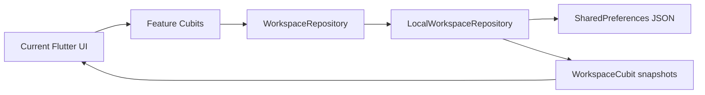
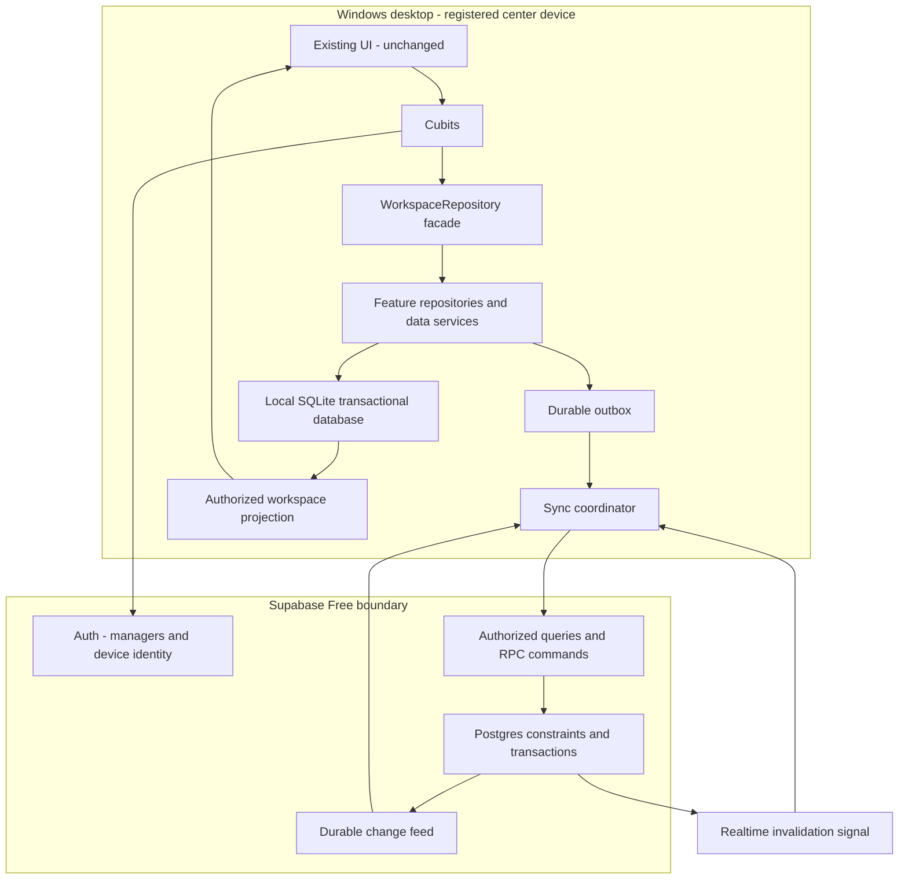
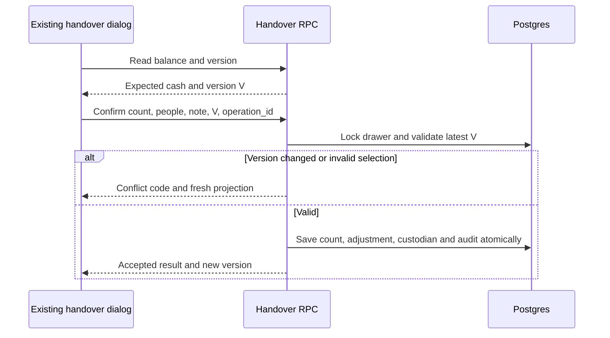
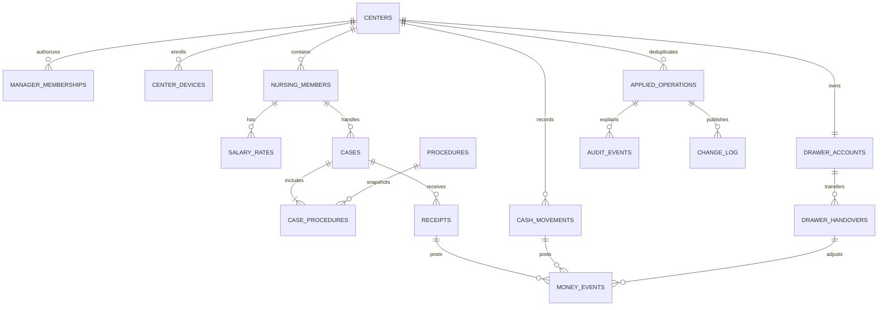
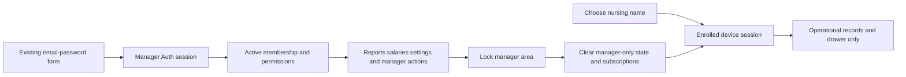
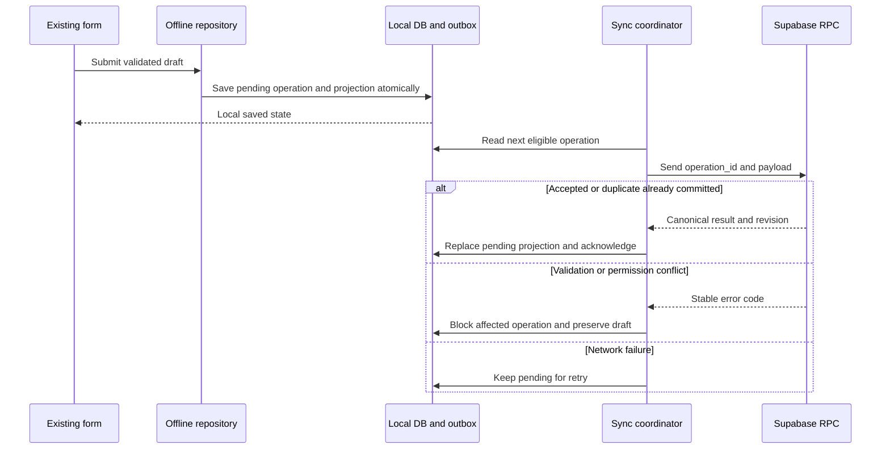
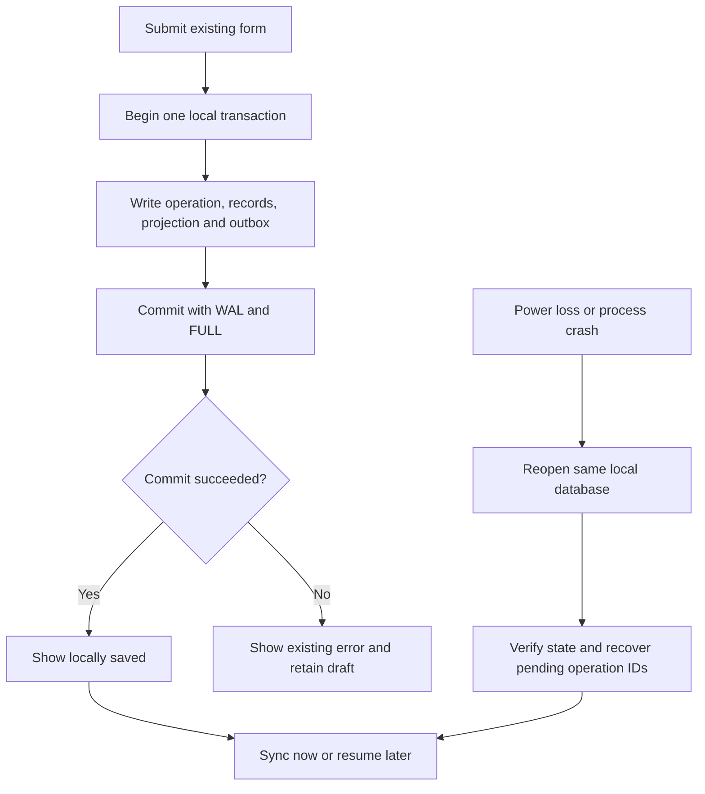

# NewCare — خطة البيزنس لوجيك والداتابيز وربط الواجهة

**التاريخ:** 30 أكتوبر 2026  
**الحالة:** مقترح للمراجعة؛ لا تنفيذ ولا إنشاء قاعدة بيانات ولا نشر في هذه المرحلة.  
**المشروع:** `D:\Work\NewCare`  
**الهدف:** تحويل الواجهة الحالية إلى نظام فعلي باستخدام Flutter + Cubit + Supabase، مع حفظ التصميم والتدفقات المعتمدة.

**تحديث النطاق:** التطبيق الإنتاجي لهذه المرحلة هو **Windows Desktop**، بتخزين محلي SQL يعمل دون الإنترنت، و**Supabase Free Plan فقط**. تصاميم المقاسات الأخرى تبقى كما هي؛ إصدار web/mobile إنتاجي ليس شرطًا لتسليم هذه المرحلة. أضيفت أدناه خطة انقطاع الكهرباء والاستعادة وحفظ البيانات عند إزالة البرنامج، مع معالجة تحذيرات Windows دون تعطيل حمايته.

## فهرس

1. الحدود والقرارات الأساسية.
2. الوضع الحالي والأجزاء التي سنستبدلها.
3. Graphify ومخططات المعمارية.
4. البيزنس رولز والحسابات.
5. الجداول والعلاقات والقيود.
6. المصادقة والصلاحيات والجهاز المشترك.
7. العمليات الذرية وواجهات الربط.
8. الأوفلاين والمزامنة والتعارضات.
9. ربط كل شاشة بالبيانات.
10. الملفات المقترحة وخطة التنفيذ.
11. الاختبارات والترحيل والتشغيل.
12. القرارات المطلوبة قبل التنفيذ ومراجع التحقق.

## 1. حدود هذه الخطة

### ثوابت لا تتغير

- الواجهة الحالية ثابتة: نفس الشاشات، ترتيب الحقول، الأزرار، الألوان، الجداول، الخطوط، التبويبات، والاستجابة للموبايل والتابلت والكمبيوتر والشاشة المربعة.
- لا إعادة تصميم ولا إضافة شاشة أو حقل جديد ضمن الربط. تحديث القيم وحالات التحميل والخطأ والمزامنة يتم داخل المكوّنات الموجودة. أي احتياج لا تسعه الواجهة الحالية يُسجّل كقرار منفصل.
- Feature-first: `data` و`presentation`؛ إدارة الحالة بـCubit؛ بلا `domain` أو Entities أو UseCases.
- لا عودة للشيفتات التشغيلية أو المستلزمات أو أسعار الإجراءات. السجلات القديمة فقط تُحفظ للتوافق.
- الإجراءات أسماء فقط، ويمكن للحالة أكثر من إجراء. إجمالي الحساب يدوي والمدفوع مستقل والمتبقي محسوب.
- داخل المركز: إجراءات، تمريض، حساب، مدفوع، وطريقة دفع. خارج المركز: نفس البيانات مع عنوان مطلوب وهاتف اختياري. لا اسم حالة يدخله المستخدم.
- التمريض يختار اسمه على جهاز المركز دون حساب شخصي. المدير له دخول فعلي منفصل، ويمكن أن يكون ضمن قائمة التمريض مع شارة «مدير».
- الدوران الظاهران فقط: تمريض ومدير؛ اختلاف صلاحيات المدير يتم بأذونات، لا بإضافة أدوار ظاهرة جديدة.
- الواجهة لا تعطي صلاحية بذاتها: إخفاء صفحة أو زر لا يكفي لحماية البيانات.
- لا commits أو push أو تثبيت Graphify أو تعديل إعداداته أو إنشاء مشروع Supabase ضمن إعداد هذا المستند.

### نطاق النسخة الأولى المقترح

مركز واحد ودرج نقدية فعلي واحد، مع دعم عدة مديرين وعدة أفراد تمريض. نستخدم `center_id` لعزل البيانات وربط الجهاز بالمركز، لا لبناء منصة اشتراكات أو نظام فروع الآن. تعدد أجهزة الصرف الأوفلاين لنفس الدرج ليس افتراضًا تلقائيًا؛ يُحسم قبل التنفيذ.

### قيد التكلفة — Supabase Free فقط

الأرقام التالية مراجعة في 30 أكتوبر 2026، ويجب إعادة التحقق قبل النشر؛ ليست ضمانًا لاستمرار الحدود دون تغيير:

| البند | الحصة المجانية المنشورة | أثرها على التصميم |
|---|---|---|
| Database | 500 MB | سجلات منظمة بلا صور/مرفقات؛ قياس الحجم مع الفهارس وaudit/change feed |
| Egress | 5 GB | pull تفاضلي وpagination؛ لا تنزيل snapshot كامل دوريًا |
| File storage | 1 GB | ليست نسخة احتياطية إلزامية؛ النظام الحالي لا يحتاج مرفقات |
| Auth | 50,000 MAU | هوية جهاز ثابتة وجلسات مدير؛ لا anonymous user جديد عند كل فتح |
| Realtime | 2 مليون رسالة شهريًا و200 اتصال peak | اتصال واحد محسوب للجهاز، مع fallback لجلب تفاضلي محدود |
| المشروعات | مشروعان نشطان | بيئة إنتاج + staging عند الحاجة؛ الاختبارات الأخرى محلية |
| عدم النشاط | المشروع المجاني قد يتوقف بعد أسبوع | تشغيل الحالات محليًا يستمر؛ استعادة الخدمة من Dashboard عند الحاجة |

هذه حصص منصة، وليست تقديرًا لسعة NewCare بالأيام أو السنوات. لا نفترض SLA أو احتفاظًا غير محدود. [Supabase Pricing](https://supabase.com/pricing)

**قرار معتمد: لا نستخدم Supabase Edge Functions في هذا النظام.** Flutter يتعامل مباشرة مع Auth وData API وPostgreSQL RPC تحت RLS. لا يوجد اعتماد تشغيلي أو إداري على Edge Functions.

إنشاء حسابات المديرين والدعوات يتم إداريًا من Supabase Dashboard. اعتماد الجهاز يتم عبر PostgreSQL RPC محمي لجلسة مدير. لا ينشئ تطبيق Windows مستخدمي Auth عبر Admin API ولا يحتوي service-role key. إذا طُلبت لاحقًا إدارة حسابات ذاتية تتجاوز هذا التدفق، يُعاد تصميمها ضمن القرار الصريح بعدم استخدام Edge Functions.

- لا تفعيل Pro أو PITR أو إضافات مدفوعة أو خدمات email مدفوعة ضمنيًا، ولا إدخال بطاقة أو ترقية تلقائية بواسطة التنفيذ.
- عند حدود الخدمة أو توقفها: نحفظ outbox محليًا ونوقف retries العدوانية، ونوضح حالة sync. لا نسقط عملية محلية محفوظة ولا ندعي مزامنتها.
- مراقبة الاستهلاك والحجم، مع حدود تنبيه مبكرة مقترحة عند 70% و85%. الوصول لحد السعة قرار تشغيل، لا مبرر لحذف تاريخ الحالات أو audit سرًا.
- لا calls وهمية لمنع pause؛ طلبات التشغيل العادية فقط. لا افتراض أن الـFree سيظل كافيًا لأي حجم بيانات.
- Free لا يقدّم نفس النسخ اليومية المتاحة للخطط المدفوعة؛ نرتب exports ونسخًا خارج الجهاز واستعادة مجربة، لا نعتمد على Dashboard backup كحماية مجانية مضمونة. [Supabase backups](https://supabase.com/docs/guides/platform/backups)
- تكلفة Supabase المستهدفة صفر داخل الحصة. شهادة توقيع Windows أو قرص backup أو UPS قد تكون لها تكلفة منفصلة؛ لا شراء أو اشتراك دون اعتماد، ولا وعد بأن شهادة مجانية ستزيل كل التحذيرات.

## 2. ما الموجود فعلًا الآن؟

| الجزء | الحالة الحالية | التغيير المخطط خلف الواجهة |
|---|---|---|
| الشاشات والمكوّنات | واجهة قابلة للتشغيل ومختبرة | تثبيتها كمرجع بصري |
| `app/newcare_app.dart` | حقن Cubits وrepository محلي | حقن adapters إنتاجية بحسب البيئة |
| `app/cubit/app_cubit.dart` | تنقل ولغة وقفل مدير محلي | فصل المصادقة الفعلية عن التنقل مع الحفاظ على الربط |
| `WorkspaceRepository` | عقد واسع تعتمد عليه الواجهة | إبقاؤه كواجهة توافق أثناء الانتقال |
| `LocalWorkspaceRepository` | تخزين JSON، تحقق محلي، حسابات وسجل تدقيق | إبقاؤه لـdemo والاختبارات؛ استبدال adapter الإنتاج تدريجيًا |
| `WorkspaceCubit` | ينشر snapshot للواجهة | snapshots محدودة حسب صلاحية المستخدم، لا نسخة مدير مخفية لدى التمريض |
| `SharedPreferences` | بيانات المعاينة وتفضيلات محلية | التفضيلات فقط؛ العمليات والسجلات إلى مخزن محلي منظم |
| كلمة مرور المدير | قفل معاينة وبصمة محفوظة محليًا | Supabase Auth؛ لا نقل لبصمة المعاينة باعتبارها حسابًا فعليًا |
| التقارير | حسابات محلية من السجلات | read models/query endpoints محمية ومتوافقة مع التعريفات الحالية |
| السجلات التاريخية | `workspace/data/models/legacy/shift_record.dart` | قراءة/ترحيل محكوم، دون تشغيل شيفتات جديدة |

آخر تحقق من التنضيف: 74 اختبارًا ناجحًا، ومقارنة 28 معاينة لمحتوى الشاشات مع استبعاد شريط الساعة المتغير. هذه baseline للربط، وليست إثباتًا لوجود backend إنتاجي.



## 3. Graphify والمعمارية

### حالة Graphify بشفافية

ظهر تعريف إضافة Graphify محليًا، لكن أدواتها ليست متاحة في هذه الجلسة، ولم يعرض البحث عنها اتصالًا يمكن استخدامه. أمر `graphify` كذلك غير موجود على PATH. **لم يُشغّل Graphify ولم تُنشأ منه خريطة للمشروع.** المخططات في هذا المستند Mermaid أُعدّت من فحص الملفات والمتطلبات؛ ليست exports من Graphify.

Graphify سيكون مهمة التحقق الأولى في التنفيذ، ولا يمنع غيابه مراجعة الخطة الحالية. توثيقه الرسمي يعرض تحليل المشروع والاستعلام عن العلاقات وتصدير call-flow. يجب التحقق من تغطية Dart في الإصدار المختار قبل اعتبار نتائج التحليل كاملة. [المصدر الرسمي](https://github.com/Graphify-Labs/graphify)

### خطة استخدام Graphify — لاحقًا، دون تغيير كود التطبيق

1. استخدام الاتصال المتاح إن ظهر، واختيار مستودع `Desha29/NewCare` صراحةً والتحقق من revision المفهرس.
2. مقارنة revision بالنسخة المحلية؛ تغييرات التنضيف المحلية قد لا تكون موجودة على GitHub بعد. الخريطة البعيدة القديمة لا تمثل working tree تلقائيًا.
3. عند اختيار التشغيل المحلي لاحقًا: تثبيت الحزمة الرسمية المعتمدة بإصدار مثبت في بيئة أدوات معزولة، ومراجعة `graphify --help` قبل الأوامر. لا تثبيت hooks أو تعديل `AGENTS.md` تلقائيًا.
4. تحليل `lib` و`test` وملفات الخطة والـSQL عند إنشائها. استبعاد `.git` و`build` و`.dart_tool` وملفات البيئة والأسرار والبيانات الحقيقية ونسخ قواعد البيانات.
5. عدم رفع المشروع أو البيانات إلى خدمة خارجية ضمنيًا؛ تحديد نطاق المصدر المسموح قبل أي فهرسة سحابية.
6. طلب خرائط: UI→Cubit→repository، واعتماد الشاشات على البيانات، ومسارات الاستلام والخوارج والتحصيل، والاختبارات المرتبطة بكل عملية.
7. مراجعة كل edge مهم بموقع الملف/الرمز. العلاقات غير المثبتة تُعلَّم `proposed` أو `unverified`؛ لا تتحول استنتاجات Graphify إلى حقائق تنفيذية.
8. حفظ metadata تتضمن revision، بصمة working tree، إصدار الأداة، النطاق والاستبعادات، ووقت التحليل. حفظ النتائج تحت `docs/architecture/graphify/` عند تشغيله فقط.
9. تصدير graph/report وcall-flow HTML إن دعمهما الإصدار، ثم ربطهما بهذا الملف. عدم اختراع أسماء مخرجات لم يولدها الإصدار المستخدم.

أسئلة التحليل المطلوبة:

- ما الذي يقرأ `WorkspaceSnapshot` كاملًا؟ أين يمكن أن تتسرب رواتب المدير إلى جهاز التمريض؟
- ما مسار `CaseCubit.save/receive/setPrice` حتى التخزين والتقارير؟
- ما الذي يتغير في رصيد الدرج عند receipt أو outgoing أو handover؟
- ما الاختبارات التي تغطي retry وoverpayment والسجلات القديمة؟
- هل بقي وصول إنتاجي مباشر إلى `SharedPreferences` لبيانات الحالات أو بصمة كلمة مرور المعاينة؟

### المعمارية المستهدفة المقترحة



**اختيار معماري:** تطبيق Flutter Windows واحد وPostgres واحد، لا microservices ولا message broker مستقل ولا Edge Functions. العمليات المالية داخل transactions في Postgres عبر RPC؛ إدارة مستخدمي Auth تتم من Dashboard، وصلاحيات التطبيق عبر RLS وعضويات المديرين والأجهزة.

**الاختيار المحلي لهذه المرحلة:** SQLite مدمجة في تطبيق Windows وراء عقد `LocalDataStore`، وDrift مرشح لإدارتها بعد تجربة الـdriver والتشفير. لا نحتاج خادم SQL Server أو Windows service منفصلة لتسجيل الحالات. web/WASM يؤجل لإصدار آخر؛ تفاصيله ليست أساس ضمان حفظ بيانات نسخة Windows. [توثيق Drift للمنصات](https://drift.simonbinder.eu/platforms/web/)

لا تخزين للبيانات الحساسة في `SharedPreferences`. التشفير وإدارة المفاتيح على native والويب يُحسمان في تجربة التخزين؛ لا نفترض أن حل native يحمي ملفات المتصفح بالطريقة نفسها.

## 4. البيزنس رولز — مرجع التنفيذ

### الحالات والتحصيل

| القاعدة | تطبيقها على الخادم |
|---|---|
| حالة داخل/خارج المركز | نوع واحد معلوم؛ عنوان الخارج مطلوب بعد trim والهاتف اختياري |
| بيانات الداخل | العنوان والهاتف فارغان؛ لا حقول تعريف إضافية لم تُطلب |
| إجراء واحد أو أكثر | اختيار إجراء صالح، مع snapshot للاسم التاريخي، بلا سعر للإجراء |
| التمريض المسؤول | عضو نشط من نفس المركز؛ الحساب المدير منفصل عن الاسم المختار |
| إجمالي يدوي | integer minor units بعملة EGP؛ غير سالب ولا أقل من صافي التحصيل المعتمد |
| مدفوع أولي صفر | يُقبل دون إنشاء receipt بقيمة صفر |
| تحصيل لاحق | receipt موجب، cash أو wallet، مرتبط بالحالة ومسجل العملية |
| المتبقي | الإجمالي − صافي الإيصالات؛ لا عمود قابل للتعديل مستقل |
| منع الزيادة | التحصيل الجديد لا يتجاوز المتبقي بعد قفل الحالة وقراءة أحدث بيانات |
| تعديل التمريض للسعر | يسمح بتعديل الإجمالي فقط، دون تعديل الإيصالات أو حقول الإدارة |
| تعديل أسعار متزامن | `expected_version`؛ لا last-write-wins مالي |

كل receipt له وقت التحصيل الفعلي ووقت استلامه على الخادم. التقارير المالية تضعه في تاريخ تحصيله، وليس تاريخ الحالة الأصلية.

عمود طريقة الدفع الحالي والفلتر يمثلان **الطريقة المسجلة عند إنشاء الحالة**؛ الدفعات اللاحقة تحتفظ بطرقها المستقلة. لا نغيّر معنى الفلتر إلى «أي دفعة» دون قرار منفصل.

### الدرج والخوارج

```text
المتبقي للحالة = إجمالي الحساب − صافي إيصالات الحالة

رصيد الدرج = رصيد افتتاح معتمد
           + تحصيلات الكاش
           + إيداعات نقدية
           − خوارج المركز
           − خوارج الأشخاص، بما فيها السلف والمكافآت المدفوعة
           ± تسويات العدّ المعتمدة والقيود العكسية
```

- المحفظة لا تدخل الدرج النقدي. تسجيلها محاسبي؛ لا يعني تكاملًا مع مزود محفظة أو تنفيذ تحويل مالي.
- نوعا الخوارج: المركز والأشخاص. سلفة التمريض نوع داخل خوارج الأشخاص وتدخل خصم السلف. سلفة شخص آخر لا تُخصم من راتب تمريض.
- المكافأة إذن مدير فقط وهي مبلغ مصروف بالفعل؛ لا تُضاف مرة ثانية إلى المستحق بعد خصمها من الدرج.
- الرصيد لا يكون حقلًا يعدّله Flutter؛ يُشتق من قيود معتمدة. الرصيد المحلي قد يتضمن عمليات pending ويُعرض مع حالة المزامنة الموجودة.
- نتيجة آخر عدّ شيء مستقل عن الرصيد الحالي؛ لا نعرض «مطابق» كحكم على حركات تمت بعد العدّ.

### تسليم واستلام عهدة الدرج

1. اتصال متاح، والجهاز صاحب العهدة لا توجد عليه عمليات نقدية معلقة أو متعارضة.
2. قراءة الرصيد و`drawer_version` من الخادم.
3. اختيار مسلّم ومستلم نشطين ومختلفين؛ بعد أول تسليم يجب أن يطابق المسلّم صاحب العهدة الحالي.
4. عدّ مبلغ غير سالب، وسبب مطلوب عند الاختلاف.
5. RPC يقفل الدرج ويتحقق من version والهوية والصلاحية والأسماء والرصيد.
6. يسجّل handover وفرق العدّ وقيد التسوية وتغيير صاحب العهدة وaudit في transaction واحدة.
7. تغير الرصيد قبل التأكيد يرفض العملية ويعيد القراءة عبر رسالة الخطأ الموجودة، ولا يعتمد عدًّا على رقم قديم.



الأوفلاين لا يسمح باعتبار تسليم العهدة نهائيًا. وجود عمليات كاش على جهاز آخر غير متصل لا يمكن اكتشافه بالسحر؛ لذلك افتراض MVP هو جهاز عهدة نقدية رئيسي واحد. توسيع ذلك يحتاج سياسة تشغيل واضحة.

### التعديل والحذف والمرتبات

- تعطيل التمريض أو الإجراء يكون archive؛ لا كسر لمراجع الحالات السابقة.
- حذف/تعديل حركة مالية معتمدة لا يمسح التاريخ: قيد عكسي وتسجيل بديل عند الحاجة، مع actor وسبب وتاريخ.
- حذف حالة مدفوعة لا يعني تلقائيًا رد مبلغ فعلي. إلى أن يُحسم الفرق بين إلغاء إدخال خاطئ ورد نقدية، يمنع backend هذه العملية برسالة موجودة بدل افتراض استرداد مالي.
- أي إلغاء لإيصال أو خارِج يعيد حساب المتبقي والدرج والتقارير من القيود، ولا يترك أرقامًا مخزنة مستقلة قابلة للاختلاف.
- الحفاظ أولًا على معنى شاشة المرتبات الحالية: الراتب الأساسي المسجل − سلف التمريض في الفترة؛ المكافآت المصروفة عمود مستقل. لا إضافة حساب حضور أو خصومات يومية أو صرف رواتب كامل غير موجود بالواجهة.
- تغيير الراتب يُسجل بتاريخ سريان دون طلب سبب جديد في UI. التعامل مع تغيير الراتب وسط الشهر والفترة المخصصة قرار مطلوب قبل اعتماد payroll إنتاجيًا.

## 5. تصميم قاعدة البيانات المقترح

الأسماء التالية تصميم مستهدف وليست migrations أُنشئت. كل مرجع بين سجلات تشغيلية يتحقق من نفس `center_id`، وليس من UUID وحده.

| الجدول | أهم البيانات | ملاحظات |
|---|---|---|
| `centers` | id، الاسم، currency، timezone | EGP وAfrica/Cairo مبدئيًا |
| `manager_profiles` | auth_user_id، display_name | كلمات المرور لدى Auth فقط |
| `manager_memberships` | center، auth_user، staff_id اختياري، active، permission flags | عدة مديرين؛ لا role ظاهري إضافي |
| `center_devices` | center، device_auth_user_id، active، primary_drawer flag | جهاز معتمد؛ ليست قائمة أسماء التمريض |
| `nursing_members` | id، center، name، active | بيانات تشغيلية بلا راتب في استجابة التمريض |
| `salary_rates` | staff، amount_minor، effective_from | جدول خاص بالمدير |
| `procedures` | id، center، name_ar، name_en اختياري، active | بلا سعر ولا كمية ولا supplies |
| `cases` | id، center، staff، location، address، phone، total_minor، initial_method، recorded_at، version، status | لا حقل اسم حالة قابل لإدخال المستخدم |
| `case_procedures` | case، procedure، name snapshots، position | عدة إجراءات؛ الأسماء التاريخية لا تتغير بتعديل الكتالوج |
| `receipts` | id، case، amount_minor، method، paid_at، actor، device | المدفوع الأول واللاحق صفوف في مصدر واحد |
| `cash_movements` | id، category، purpose، recipient_kind/id/name، amount، description | دخل/خوارج؛ receipt ليس movement إضافيًا |
| `drawer_accounts` | id، center، custodian_staff_id، version | درج واحد في MVP؛ balance مشتق |
| `money_events` | id، center، source، type، method، signed_minor، occurred_at، reversal_of | دفتر مالي موحد؛ cash فقط يؤثر في الدرج |
| `drawer_handovers` | drawer، from/to، expected، counted، difference، note، version | سجل مستقل عن الشيفتات |
| `audit_events` | actor_auth، device، selected_staff، action، before/after، operation_id، server_time | append-only؛ لا تخزين أسرار |
| `applied_operations` | center، operation_id، payload_hash، result | منع تكرار العملية وإعادة نتيجتها |
| `center_sync_state` | center، committed_revision | تسلسل تغييرات مضبوط تحت lock |
| `change_log` | center، revision، operation_id، affected records/tombstones | feed دائم للمزامنة |
| `center_settings` | center، navigation labels per language | الأسماء المخصصة مشتركة حسب القرار؛ تفضيل اللغة للجهاز محلي |

`receipts` و`cash_movements` مصادر تشغيلية، و`money_events` إسقاط مالي مضبوط يُكتب معها في نفس المعاملة. لا تجمع التقارير السجلين معًا وإلا ستضاعف الأموال. uniqueness على مصدر الحدث يمنع إنشاء قيد مالي مكرر.



في الرسم علاقة handover→money_events اختيارية: العدّ المطابق لا يحتاج مبلغ تسوية. القيد الافتتاحي له مصدر مستقل معتمد. مفاتيح الربط الفعلية ستُحسم في ERD التفصيلي قبل SQL.

### القيود والفهارس

- أموال `bigint` بالقروش؛ لا float، وإثبات نطاق النقل الآمن بين Dart Web وJSON/Postgres ضمن حدود معتمدة.
- `CHECK` للنوع والطريقة والقيم غير السالبة؛ amount الإيصالات والخوارج موجب.
- FK مركب أو تحقق معاملة يرفض الربط عبر مركزين؛ يمنع حذف مرجع تاريخي.
- UUID يولّد قبل التخزين المحلي؛ unique `(center_id, operation_id)` وunique source event.
- `version` على السجلات المعدلة، وtimestamps من نوع `timestamptz`، وأسماء واضحة لوقت الحدث ووقت الاستلام على الخادم.
- عدم اعتبار ساعة الجهاز مصدر ثقة مطلقًا: نحفظ وقت الإضافة الأوفلاين، ووقت الخادم، ونرصد الانحراف؛ صلاحية backdating خاصة بالمدير.
- فهارس مبدئية على `(center_id, recorded_at, id)`، `(center_id, location, recorded_at)`، `(case_id, paid_at)`، `(center_id, method, occurred_at)` و`(center_id, revision)`؛ مراجعة EXPLAIN قبل إضافة فهارس أخرى.
- منع overpayment و`total < paid` داخل المعاملة بعد locks، لا عبر `CHECK` يقرأ مجموع جدول آخر بصورة غير آمنة.
- البحث العربي يحتاج تجربة normalization وفهرسة وفق البيانات الفعلية؛ لا وعد أن بحث PostgreSQL الافتراضي يحل كل اختلافات الكتابة.
- لا UPDATE/DELETE مباشر من client للجداول المالية أو audit أو سجل العمليات.

## 6. المصادقة والصلاحيات

### هوية الجهاز وهوية المدير

اختيار اسم تمريض ليس إثبات هوية فردية. audit يجب أن يفرق بين:

1. `actor_auth_user_id`: الجلسة المعتمدة التي أرسلت العملية.
2. `device_id`: الجهاز المعتمد.
3. `selected_staff_id`: التمريض المختار؛ نسبة تشغيلية وليست توقيعًا شخصيًا موثقًا.

المقترح: جلسة جهاز محدودة الصلاحيات تُنشأ بصمت وتُربط بالمركز بعد اعتماد مدير. يمكن تجربة Anonymous Auth لهذا الغرض، لكن حساب anonymous ليس مجرد publishable key، ولا يكون معتمدًا تلقائيًا لمجرد أنه authenticated. [التمييز في توثيق Supabase](https://supabase.com/docs/guides/auth/auth-anonymous)

جلسة المدير منفصلة عن جلسة الجهاز في طبقة المصادقة والتخزين. قفل مساحة المدير يلغي وصولها ويفرغ بياناتها الحساسة دون قطع تشغيل جهاز التمريض. لا حفظ لتوكن مدير طويل الأجل في مخزن التمريض المشترك.



### أول مدير وإعداد الجهاز — قرار لازم قبل التنفيذ

شاشة الإعداد الحالية تحتوي اسم المدير وإيميله فقط؛ لا يوجد password/verification flow لإنشاء حساب Auth كامل منها. الاقتراح المتوافق مع تجميد UI:

- تهيئة أول مدير موثوق خارج التطبيق عبر دعوة/إعداد إداري آمن، وتعيين كلمة مروره عبر تدفق Auth المعتمد.
- يدخل من شاشة المدير الحالية، ثم يُربط جهاز المركز بالمركز بصلاحية enrollment.
- شاشة الإعداد الموجودة تحفظ بيانات المركز والتمريض والإجراءات لحساب معتمد؛ لا تمنح صلاحية manager لإيميل كتبه أي شخص.
- إنشاء المديرين الإضافيين وتعديل صلاحياتهم يتم إداريًا حتى يُطلب UI لذلك؛ شاشة الإعدادات الحالية بقيت لبيانات المدير وكلمة مروره وأسماء الأقسام.
- إن كان المطلوب onboarding ذاتيًا داخل التطبيق بالكامل، فهذا يحتاج تدفقًا غير موجود ويستلزم موافقة منفصلة على UI؛ ليس تنفيذًا خفيًا ضمن الربط.

### مصفوفة صلاحيات مقترحة

| العملية | جهاز تمريض معتمد | مدير مخوّل |
|---|---|---|
| قراءة كتالوج وإظهار أسماء التمريض | نعم، دون الرواتب | نعم |
| إضافة حالة وتحصيلها | نعم حسب الجهاز والمركز | نعم |
| تغيير إجمالي حالة | نعم، الإجمالي فقط وبحد المدفوع | نعم بحسب الإذن |
| إضافة خوارج مركز/أشخاص وسلفة | نعم | نعم |
| مكافأة | لا | `manage_payroll` |
| قراءة رصيد الدرج وتسليم العهدة | نعم، نطاق الدرج فقط | نعم |
| إجماليات الإدارة والتقارير والتصدير | لا | `view_reports` |
| الرواتب | لا | `view_payroll` / `manage_payroll` |
| تعديل/إلغاء سجل مالي | لا | `correct_financial_records` |
| إدارة التمريض والكتالوج | لا | `manage_nursing` / `manage_catalogue` |
| إضافة مدير أو تغيير أذوناته | لا | `manage_managers` |
| تعديل بياناته وكلمة مروره | لا | حساب المدير نفسه |
| أسماء أقسام القائمة للمركز | لا | `manage_settings` |

لا يجوز تعطيل آخر مدير قادر على إدارة المديرين. المدير الذي يختار اسمه كتمريض لا يحصل على جلسة إدارة لمجرد الاسم أو الشارة.

### حماية البيانات الحقيقية

- RLS وأذونات SQL على كل جداول API المكشوفة، وقراءة membership/device الفعّالة على الخادم. لا صلاحيات من `user_metadata` القابل لتعديل المستخدم. [مرجع RLS](https://supabase.com/docs/guides/database/postgres/row-level-security)
- الجداول المالية الخاصة والرواتب وسجلات audit في schema خاص أو وصول مقيد؛ RLS للصفوف ليس حجبًا تلقائيًا لأعمدة salary.
- استجابة التمريض لا تحتوي رواتب أو إجماليات إدارة أو بيانات مدير حساسة، حتى لو كانت الشاشات تخفيها.
- DTO/snapshot تشغيلي وآخر إداري، مع cache منفصل؛ منع بقاء snapshot مدير كامل داخل `WorkspaceCubit` بعد القفل.
- RPCs تفحص الإذن ولا تعتمد فقط على `managerUnlocked` في Flutter. الدوال المرتفعة الصلاحية تُقيد بالـEXECUTE وsearch_path وأسماء جداول صريحة. [مرجع الدوال](https://supabase.com/docs/guides/database/functions)
- publishable key فقط في التطبيق؛ Admin/service secrets في بيئة الخادم. لا نقل لكلمة المرور أو التوكن إلى audit أو Graphify أو logs.
- تغيير كلمة المرور من النموذج الحالي يمر بإعادة التحقق ثم Auth، لا تحديث hash محلي. عضوية المدير قابلة للإلغاء من الخادم حتى لو كانت token قديمة.
- العمليات الإدارية الحساسة online-only في النسخة الأولى. استمرار جهاز أوفلاين بعد إلغاء اعتماده خطر متبقٍ؛ يعالج بمدة اعتماد محدودة وسياسة جهاز، لا بادعاء إمكانية إلغاء وصول أوفلاين فورًا.

## 7. عقود العمليات وربط Flutter

العقد الخارجي الحالي يبقى facade لتقليل تغيير واجهات Cubits. خلفه نفصل repositories بحسب المسؤولية؛ لا نفصل لمجرد زيادة عدد الملفات.

| الاستدعاء الحالي/الوظيفة | العملية المقترحة | المعاملة |
|---|---|---|
| `CaseCubit.save` | `create_case` | الحالة + الإجراءات + أول receipt إن وجد + القيود + audit + change envelope |
| `CaseCubit.receive` | `record_case_receipt` | lock للحالة، تحقق المتبقي، receipt وledger مرة واحدة |
| `CaseCubit.setPrice` | `change_case_total` | expected version، حد المدفوع، audit |
| `DrawerCubit.save` | `record_cash_movement` | تصنيف المستلم والغرض والإذن ثم ledger وaudit |
| `DrawerCubit.handover` | `handover_drawer` | lock/version وعدّ وتغيير العهدة وتسوية |
| تعديل/حذف مدير | commands محددة حسب النوع | تعديل تشغيلي أو reverse/replace مالي؛ بلا generic table update من client |
| إضافة/تعديل تمريض | `save_nursing_member` / archive | بيانات عامة + راتب بإذن منفصل |
| إضافة/تعديل إجراء | `save_procedure` / archive | الاسم فقط |
| إعدادات المدير | profile/password/settings services | Auth للهوية؛ RPC للإعدادات |
| analytics/CSV | استعلامات محمية مشتركة التعريف | نفس الفترة والفلاتر والمصادر المالية |

### غلاف كل command

`operation_id`, `schema_version`, `device_id`, `selected_staff_id` عند الحاجة، `expected_version` عند التعديل، `occurred_at_client`, وpayload. الـactor الحقيقي والمركز والإذن يتحقق منهم الخادم، ولا يثق في center أو role مرسلة من UI.

إعادة نفس operation مع نفس payload تعيد نفس النتيجة دون تكرار receipt أو outgoing. إعادة UUID نفسه بpayload مختلف ترفض. حفظ أثر العملية ونتيجتها يتم مع المعاملة نفسها؛ timeout بعد commit ثم retry لا يسجل المبلغ مرتين.

ترتيب locks ثابت: revision الخاص بالمركز، ثم السجلات المستهدفة بترتيب IDs، ثم حساب الدرج. النسخة الأولى لمركز صغير تفضل صحة الحساب وبساطة المعاملات على تحسينات توازي مبكرة.

الدوال العامة ترجع أكواد أخطاء مستقرة: `forbidden`, `version_conflict`, `overpayment`, `total_below_paid`, `stale_drawer`, `device_revoked`, `offline_not_allowed`. تُترجم إلى رسائل عربية/إنجليزية داخل `OperationError`/المكوّنات الموجودة، مع الاحتفاظ بالمدخلات عند الفشل.

## 8. الأوفلاين والمزامنة

### مبدأ الحفظ

لا وعود exactly-once عبر الشبكة: إرسال at-least-once مع idempotency على الخادم. محليًا تُحفظ العملية والإسقاط الذي يراه المستخدم في transaction واحدة، ثم يبدأ الإرسال.



### البيانات المحلية

- جداول تشغيلية محدودة للصلاحيات، وoutbox بحالات `pending/sending/acknowledged/rejected/conflict`، وcursor وسجل migration محلي.
- حفظ الرد canonical وإزالة الإسقاط pending بطريقة لا تحتسب القيمة مرتين؛ لا جمع snapshot الخادم مع الإيصال المحلي نفسه.
- إعادة التشغيل أثناء الإرسال تعيد `sending` إلى قابل للاستئناف؛ لا فقد لعملية محفوظة.
- ترتيب حسب الاعتماد: create case قبل receipt الخاص بها؛ فشل حالة يمنع إرسال الدفعات التابعة لها حتى التصحيح.
- retries بتأخير متدرج وjitter للشبكة/الأخطاء المؤقتة فقط. أخطاء المنطق/الإذن لا تُعاد بلا حد.
- انتقال Offline/Syncing/Synced/Failed يستخدم مؤشر المزامنة والرسائل الموجودة؛ لا حالة Synced قبل ack من الخادم.
- نجاح `ActionCubit` أثناء الأوفلاين يعني الحفظ المحلي الدائم فقط، وليس قبول قاعدة البيانات النهائي.

### Pull وRealtime

Realtime إشارة لإعادة الجلب؛ لا يعتمد النظام عليه كسجل تغييرات مضمون الاسترجاع. التصميم يضيف `change_log` دائمًا مع cursor. [مرجع إشعارات Postgres](https://supabase.com/docs/guides/realtime/postgres-changes)

لمنع فقد commit متأخر بسبب sequence محجوز مبكرًا: كل mutation للمركز يقفل صف `center_sync_state` أولًا ويزيد revision داخل نفس transaction. تُرسل التغييرات كغلاف عملية كامل، مع tombstones للأرشفة/الإلغاء، ولا يُقسّم نصف غلاف عند pagination. يحفظ العميل الغلاف والcursor معًا بعد نجاح المعاملة المحلية.

عند فقد cursor أو تجاوز مدة احتفاظ الـfeed: full resync محكوم مع الاحتفاظ بالـoutbox ومنع ازدواج pending. feed وRealtime مقيدان بنفس صلاحيات البيانات؛ إشعار تمريض لا يكشف salary أو manager totals.

### سياسة التعارض

| السيناريو | القرار |
|---|---|
| تعديل إجمالي وحصول دفعة على جهاز آخر | إعادة تحقق؛ رفض الإجمالي إن أصبح أقل من التحصيل |
| دفعتان تتجاوزان المتبقي معًا | واحدة تُقبل حسب القفل، والأخرى تتعارض دون قيد مالي |
| جهاز أعاد عملية بعد timeout | نفس النتيجة ولا تكرار |
| إجراء/تمريض تم تعطيله أثناء الأوفلاين | لا تجاهل للتحقق؛ رسالة وتصحيح draft قبل إعادة الإرسال |
| عدّ نقدية على رقم قديم | رفض وتسوية من رصيد حديث، دون استبدال العدّ سرًا |
| تعديل metadata مختلف | version conflict؛ لا دمج مالي تلقائي |
| الجهاز ألغي اعتماده | وقف sync، فصل البيانات الإدارية، واسترداد التشغيل وفق اعتماد جديد |
| عدم وجود UI مناسب لحل تعارض | إيقاف العملية المتعارضة وإظهار الخطأ الحالي؛ إضافة conflict screen تحتاج قرار UI منفصل |

### حدود الأوفلاين التي يجب اختبارها

المتصفح قد يمنع التخزين أو يمسحه؛ multiple tabs تحتاج writer coordination. حفظ local key بجوار ciphertext ليس حماية كافية. جهاز المركز يحتاج سياسة نظام وتشغيل ونسخ احتياطي مناسبة. لا تُكتب بيانات حالات حقيقية حتى تنجح تجربة التخزين والاستعادة وتُعتمد المخاطر المتبقية.

الملاحظة الخاصة بالمتصفح تخص إصدارًا مستقبليًا. تسليم هذه المرحلة يعتمد على SQLite native وWindows، ولا يضع درج المركز الإنتاجي في browser cache.

### 8.0 المزامنة خطوة بخطوة لكل عملية

المزامنة تلقائية أثناء فتح البرنامج، وعند بدء تشغيله، وعند رجوع الاتصال، وبناءً على إشعارات التغيير أو الجلب التفاضلي المحدود. لا ندّعي إرسال عمليات والبرنامج مغلق دون خدمة خلفية منفصلة؛ لا توجد خدمة كهذه ضمن الخطة الحالية.

**المسار المشترك:** كتابة في SQLite + outbox داخل معاملة واحدة ← نجاح الحفظ المحلي ← إرسال نفس operation ID إلى PostgreSQL RPC مباشرة ← تحقق ومعاملة خادم ← ack محفوظ محليًا ← حالة «تمت المزامنة».

البيانات التشغيلية تبقى محليًا بعد sync. الذي يتغير هو حالة العملية من pending إلى acknowledged، واستبدال الإسقاط المؤقت بالنتيجة المعتمدة، لا حذف الحالة أو الإيصال من الجهاز ولا جمع نفس المبلغ مرتين.

#### أ. إضافة حالة داخل أو خارج المركز

1. النموذج يتحقق من التمريض والإجراءات والإجمالي والمدفوع؛ عنوان الخارج مطلوب والهاتف اختياري.
2. ينشأ case ID وoperation ID مرة واحدة. تحفظ SQLite الحالة والإجراءات وأول تحصيل إن كان أكبر من صفر، مع outbox وإسقاط الرصيد في commit واحد.
3. بعد commit تظهر الحالة فورًا في دفترها وتظهر حالة الحفظ المحلي. إذا كان المدفوع cash يزيد الرصيد المحلي بهذا المدفوع فقط؛ wallet لا تغير الدرج. المتبقي = الإجمالي − المدفوع.
4. مع الاتصال يرسل worker العملية إلى `create_case`، دون Edge Functions. الـRPC يتحقق من صلاحية الجهاز والعضو والقيود ويكتب الحالة والإيصال والقيد وaudit في transaction واحدة.
5. إذا قُبلت، يخزن العميل canonical result ويعلّم العملية acknowledged. الزيادة النقدية السابقة لا تتكرر؛ هي نفس العملية التي انتقلت من pending إلى confirmed.
6. إذا كانت offline تبقى العملية في outbox بعد إغلاق البرنامج أو إعادة تشغيل Windows. إذا رفضها الخادم عند الاتصال تبقى محفوظة للتصحيح وتظهر رسالة واضحة؛ لا تختفي ولا تُسمى synced.

#### ب. إضافة خوارج مركز أو أشخاص أو سلفة

1. تحفظ الحركة وتصنيفها ومستلمها ومسجلها وقيمتها وoperation ID محليًا في نفس معاملة outbox.
2. بعد نجاح الحفظ ينقص الدرج المحلي مرة واحدة. سلفة تمريض تؤثر كذلك في إسقاط سلفه؛ صرف لشخص خارجي لا يغير راتب تمريض.
3. يرسل worker إلى `record_cash_movement`، ويتحقق الخادم من الإذن والتصنيف والمبلغ ثم يكتب القيد وسجل التدقيق.
4. ack لا يخصم المبلغ ثانية. انقطاع الشبكة يعني انتظار الإرسال أو تأكيد نتيجة العملية نفسها، وليس إنشاء حركة جديدة.

#### ج. تحصيل دفعة لاحقة لحالة

1. يحفظ receipt جديدًا بمعرف مستقل ومبلغ وطريقة وتاريخ التحصيل، مرتبطًا بـcase ID. إذا كانت الحالة الأصلية pending يُرسل إنشاؤها أولًا.
2. ينقص المتبقي محليًا؛ يزيد الدرج فقط إذا كانت الدفعة cash.
3. عند sync يقفل `record_case_receipt` الحالة ويتحقق من أحدث متبقٍ. إذا دفعت أجهزة أخرى في الوقت نفسه فلا يقبل مبلغًا يتجاوز المتبقي.
4. قبول الخادم يثبت نفس الإيصال؛ التعارض يوقف هذا الإيصال للمراجعة ويعيد إسقاطًا صحيحًا دون مسح مسودته أو تكراره ماليًا.

#### د. تعديل إجمالي الحساب

1. SQLite تحفظ التعديل pending مع version الذي بُني عليه، بعد التحقق من المدفوع المعروف محليًا.
2. `change_case_total` يعيد التحقق من جميع التحصيلات المعتمدة على الخادم. إذا أصبح السعر أقل من المدفوع أو تغير version يرفض التعديل للتصحيح.
3. تغيير الإجمالي لا يغير النقدية ولا يعيد كتابة الإيصالات؛ يغير المتبقي فقط. لا last-write-wins ماليًا.

#### هـ. تسليم واستلام الدرج

هذه عملية نهائية تحتاج اتصالًا: يفرغ الجهاز عمليات الكاش pending أولًا، ثم يجلب رصيد الدرج وversion، ثم يعد المستخدم النقدية ويؤكد من الحوار الحالي. `handover_drawer` يتحقق تحت lock ويسجل النتيجة مرة واحدة. إذا لم يوجد اتصال يُظهر الحوار الخطأ الموجود بدل ادعاء أن العهدة انتقلت.

#### و. التعديلات الإدارية والقراءة والتقارير

- التمريض والإجراءات: save/archive وفق الإذن، ثم تحديث الكتالوج المحلي من الرد أو الـchange feed؛ لا كسر لمراجع الحالات القديمة.
- المصادقة وكلمة المرور: Auth مباشرة؛ لا توضع في outbox عامة. إنشاء المديرين إداري من Supabase Dashboard.
- التقارير: استعلامات مدير محمية من الخادم وتعريفات حساب مشتركة. سجلات العمليات المحلية pending لا تُعرض كأرقام سحابية نهائية.
- وصول تغيير معتمد من الخادم يحدث الجداول المحلية في transaction ثم يبث `WorkspaceCubit` للواجهة؛ لا حاجة لإعادة فتح الشاشة يدويًا.

#### مثال حسابي واحد

نفترض درجًا يبدأ بـ1,000 جنيه، وحالة جديدة إجماليها 200 جنيه:

| الخطوة | أثرها على الدرج | رصيد الدرج | متبقي الحالة |
|---|---|---|---|
| حفظ الحالة بمدفوع 80 كاش | +80 | 1,080 | 120 |
| وصول تأكيد sync لنفس الحالة | لا زيادة أخرى | 1,080 | 120 |
| تحصيل 50 محفظة للحالة | لا أثر نقدي | 1,080 | 70 |
| تسجيل خوارج 30 | −30 | 1,050 | 70 |
| وصول تأكيد sync للخوارج | لا خصم آخر | 1,050 | 70 |
| تسليم بعد عدّ 1,050 واتصال متاح | مطابق؛ تغيير عهدة فقط | 1,050 | 70 |

#### حالات الانقطاع التي لا تنشئ تكرارًا

- **الكهرباء انقطعت بعد local commit وقبل الإرسال:** عند الفتح يجد worker العملية pending ويرسلها بنفس ID.
- **الخادم حفظ لكن الرد لم يصل:** retry بنفس ID يرجع النتيجة المحفوظة؛ لا case أو receipt أو خصم ثانٍ.
- **وصل الرد ثم توقف البرنامج قبل حفظ ack:** نفس retry الآمن، ثم تحديث الحالة المحلية.
- **فشل local commit أصلًا:** لا تظهر رسالة نجاح، ولا نزيل مدخلات النموذج.
- **حذف/تلف القرص قبل sync:** لا تحل الشبكة ما لم يصلها؛ الاستعادة من backup المستقل حسب نافذة RPO في القسم التالي.

### 8.1 الحفظ المحلي عند انقطاع الكهرباء أو توقف التطبيق

**وعد التصميم المقصود:** العملية التي ظهرت «محفوظة على الجهاز» تكون قد أكملت commit محليًا قبل عرض النجاح، ولا تحتاج وصولًا إلى Supabase كي تبقى بعد إعادة التشغيل. العملية التي ما زالت تُكتب ولم يُعرض نجاحها لا نعد بحفظها.

إعداد مبدئي مطلوب التحقق من تطبيقه فعليًا على اتصالات SQLite المستخدمة، بعد تهيئة مفتاح التشفير إن وُجد:

```sql
PRAGMA journal_mode = WAL;
PRAGMA synchronous = FULL;
PRAGMA foreign_keys = ON;
PRAGMA busy_timeout = 5000;
```

هذه أوامر مخططة ولم تُنفذ في قاعدة حقيقية. يُقرأ الناتج للتأكد من قبول الإعدادات. اختيار WAL مع FULL يستهدف durability أقوى من WAL مع NORMAL عند فقد الكهرباء، مع تكلفة كتابة تُقاس على جهاز المركز. [SQLite synchronous](https://sqlite.org/pragma.html#pragma_synchronous)

قواعد التنفيذ:

1. سجل الحالة/الدفعة/الخارِج، والإسقاط المحلي، وoperation ID وoutbox في **قاعدة واحدة ومعاملة واحدة**. لا توزيعها بين JSON وSQLite أو بين ملفين مستقلين.
2. writer واحد تديره طبقة التخزين؛ لا تحديث لرقم الدرج من widget ولا نجاح محفوظ في RAM فقط. تنفيذ I/O بعيدًا عن UI thread.
3. انتظار COMMIT الناجح قبل نجاح Cubit. `SQLITE_FULL` أو permission denied أو I/O error أو فشل commit يعيد خطأ ويحافظ على المدخلات، ولا يحوَّل إلى نجاح.
4. قاعدة البيانات على قرص Windows محلي سليم، لا network share أو مجلد OneDrive/Dropbox تتم مزامنته حيًا. لا برنامج خارجي ينسخ أو يقفل ملف DB باعتباره ملف نص.
5. WAL جزء من حالة القاعدة. لا نحذف `-wal` أو `-shm` عند crash، ولا ننقل ملف `.db` وحده أثناء الاستخدام. إدارة checkpoint تتم عبر SQLite وتراقَب مساحتها، لا بعمليات حذف يدوية. [SQLite WAL](https://sqlite.org/wal.html)
6. عند الإقلاع تفتح القاعدة من نفس المسار، ويجري recovery المعتاد ثم فحص سلامة متدرج، وتُعاد العمليات غير المؤكدة للإرسال بنفس IDs.
7. النسخة المستخدمة من SQLite/محرك التشفير يجب أن تتضمن إصلاح WAL-reset: الإصدار 3.51.3 أو أحدث، أو backport موثق. نتحقق من المحرك الفعلي وpatches، لا من رقم حزمة Dart وحده. [تنبيه SQLite الرسمي](https://sqlite.org/wal.html#walreset)
8. نختبر crash حقيقيًا للعملية، وإعادة تشغيل VM، ومحاكاة فقد الكهرباء في بيئة اختبار مناسبة؛ اختبار رمي exception داخل Dart وحده غير كافٍ.



**حد الضمان:** SQLite لا تمنع تلف القرص نفسه أو فقد الجهاز أو حذفه عمدًا، وتعتمد durability على احترام Windows والقرص لطلبات flush. جهاز تخزين يكذب بشأن flush أو عطل مادي قد يفقد آخر عمليات حتى مع الإعداد الصحيح. UPS وقرص سليم يقللان الخطر، والنسخ المستقلة تعالج كارثة القرص. لا نعد «صفر فقد تحت أي ظرف» من نسخة وحيدة.

### 8.2 مكان بيانات Windows — التحديث وإزالة البرنامج لا يحذفانها

المسارات التالية تصميم مقترح، تُحل عبر Windows Known Folders ولا تُثبت على اسم مستخدم بعينه:

```text
Program installation:
  %ProgramFiles%\NewCare\                 executable and libraries only

Persistent operator data:
  %LOCALAPPDATA%\NewCare\Data\            database, WAL and local outbox
  %LOCALAPPDATA%\NewCare\Security\        DPAPI-protected key material
  %LOCALAPPDATA%\NewCare\Logs\            redacted diagnostic logs

Independent backup destination:
  An approved second physical disk or encrypted removable backup location
```

- ملفات البيانات ليست داخل مجلد EXE أو `build` أو temp أو `D:\Work\NewCare`. إعادة تثبيت نسخة البرنامج ليست إعادة تهيئة للبيانات.
- المقترح استخدام Windows operator account ثابت لجهاز المركز. التشغيل اليومي standard user؛ لا حاجة لـRun as administrator كل مرة.
- المثبّت/المزيل لا يسجل مجلد البيانات ضمن موارده التي يحذفها. uninstall وrepair وupgrade وrollback يحافظون على البيانات والمفاتيح والعمليات pending افتراضيًا.
- قبل فتح قاعدة موجودة يتحقق التطبيق من وجودها ونسختها. فشل الفتح لا يخلق قاعدة فارغة فوقها، ولا يرجع إلى demo، ولا يمسح SharedPreferences أو outbox كحل تلقائي.
- schema migrations versioned وتُختبر مع نسخة قبل الترقية. نسخة تطبيق أقدم لا تحاول تخفيض schema أو الكتابة في نسخة أحدث غير مدعومة.
- تنظيف البيانات نهائيًا إجراء إداري منفصل ومقصود بعد backup والتحقق من المزامنة، وليس أثرًا جانبيًا لإزالة التطبيق أو تسجيل الخروج.
- عند إعادة تثبيت البرنامج على **نفس حساب Windows** يفتح المسار نفسه ويستأنف الـoutbox. تغيير الحساب أو إعادة تثبيت Windows أو نقل الجهاز يتطلب مسار recovery، لا يُعامل كأنه نفس profile.
- إذا لزم الوصول من حسابات Windows متعددة نراجع `%ProgramData%` وACL لمجموعة مصرح بها؛ لا نفتح الصلاحيات لـEveryone أو نغيّر النطاق إلى machine-wide دون تقييم.
- اختيار MSI/EXE تقليدي موقّع هو المقترح الأول. لا نفترض بقاء بيانات MSIX الافتراضية بعد uninstall؛ Microsoft توثق حذف redirected AppData لبعض أنواع الحزم virtualized. لا نعتمد MSIX قبل اختبار retention ومسار بيانات مناسب. [MSIX file-system/uninstall behavior](https://learn.microsoft.com/en-us/windows/msix/desktop/desktop-to-uwp-behind-the-scenes)

### 8.3 إذا فشلت القاعدة المحلية قبل المزامنة

الحماية ثلاث طبقات مختلفة، ولا واحدة تلغي الأخرى:

| الطبقة | ما تحميه | ما لا تحميه وحدها |
|---|---|---|
| SQLite transaction + WAL/FULL | توقف العملية/النظام ضمن افتراضات التخزين | تلف القرص أو الحذف أو فقد مفتاح التشفير |
| Backup مشفر مستقل | استعادة آخر snapshot صالحة، بما فيها pending outbox | العمليات الأحدث من آخر backup صالح |
| Supabase sync + export | السجلات التي قبلها الخادم فعلًا | العمليات التي لم تغادر جهازًا غير متصل |

خطة النسخ المقترحة:

1. snapshot متسقة عبر SQLite Backup API أو أداة يدعمها driver المختار؛ ليس نسخ `.db` الحي وحده. الكتابة إلى اسم مؤقت، التحقق من الاكتمال والسلامة، ثم نشرها كنسخة صالحة. [SQLite Backup API](https://sqlite.org/backup.html)
2. النسخة تشمل الجداول التشغيلية وoutbox والـIDs والcursor ونسخة schema وإعدادات الاستعادة اللازمة. نسخة سجلات Supabase وحدها لا تعوّض pending المحلية.
3. نسخ دورية مقترحة كل خمس دقائق أثناء العمل، وبعد handover وقبل migrations؛ هذا **هدف قابل للقياس** يحدد RPO، وليس ضمانًا أن كل عملية وصلت لقرص ثانٍ فورًا.
4. الاحتفاظ بنسخ دورية وعدة أجيال، ونسخة على وسيط مادي مستقل؛ مجلد Backups على نفس القرص لا يحمي من تعطل ذلك القرص. السعة والمدة تعتمدان قبل التشغيل.
5. تشفير النسخ والتحقق من سلامتها، مع مفاتيح استعادة محفوظة خارج الجهاز. لا تخزين password أو recovery key كنص بجوار backup.
6. إذا كان المطلوب تحمّل **تلف القرص فورًا دون خسارة آخر عملية غير متزامنة**، فالحصة الدورية لا تكفي: نحتاج نسخة مستقلة لكل commit قبل الإقرار بالنجاح أو تخزينًا متكررًا مناسبًا، ونختبر أثره على الأداء والتكلفة. هذا قرار إضافي واضح.
7. فشل backup أو فصل قرصه لا يزيل النسخ السابقة. يسجل الخطر ويظهر التنبيه ضمن مكوّن الحالة/الخطأ الموجود؛ لا تخريب DB العاملة لمحاولة إصلاح backup.

بروتوكول recovery:

- عند corruption أو integrity failure: إيقاف الكتابات إلى الملف المتضرر والاحتفاظ به مع WAL والمفاتيح كما هو؛ لا auto-delete ولا إعادة تهيئة.
- التحقق من آخر backup، واستعادته إلى ملف جديد بعد فحصه؛ لا الكتابة فوق المصدر الوحيد.
- استعادة نفس operation IDs؛ إعادة الإرسال لا تُكرر عمليات سبق قبولها على الخادم. سجل الخادم يكمل المقبول الذي غاب عن snapshot، والـoutbox يعيد المحلي غير المقبول.
- مقارنة الرصيد والإيصالات وعدد pending قبل استئناف العمل، مع فصل الملف المتضرر للمراجعة إذا احتوى عمليات أحدث من backup.
- لا ادعاء إمكانية استرجاع عمليات غير متزامنة كانت على قرص تالف بلا نسخة ثانية. تُوثق نافذة الفقد المحتملة ويُراجعها المدير قبل اختيار RPO.
- Supabase Free يحتاج exports إدارية مستقلة وفق الإجراء الرسمي، مع اختبار schema/RLS/Auth recovery؛ لا وضع database password أو مفتاح admin في تطبيق المركز لتنفيذ dump.

### 8.4 حماية Windows والمفاتيح

- قاعدة SQL عادية ليست مشفرة تلقائيًا. نختار محرك تشفير SQLite متوافقًا ومراجعًا، ونتحقق من حماية DB وWAL والنسخ المؤقتة والـbackups؛ لا نفترض أن Drift وحده يوفر ذلك.
- مفتاح عشوائي يحمي البيانات؛ DPAPI بنطاق مستخدم Windows مرشح لحماية المفتاح محليًا. لا hardcoded key ولا الاعتماد على كلمة مرور قفل واجهة المعاينة.
- DPAPI مرتبط بسياق Windows؛ machine scope يوسع إمكانية فك الحماية على نفس الجهاز، ولذلك ليس default. يجب وجود recovery package مشفر مستقل لاستعادة البيانات بعد فقد profile أو إعادة تثبيت Windows. [Microsoft DPAPI](https://learn.microsoft.com/en-us/windows/win32/api/dpapi/nf-dpapi-cryptprotectdata)
- ACL للمستخدم/المجموعة المعتمدة وSYSTEM والإدارة المخولة فقط، مع حماية القرص مثل BitLocker عند توفرها. لا صلاحيات Everyone ولا أسرار داخل logs.
- مستخدم Windows نفسه قد يستطيع حذف ملفاته، وlocal administrator ضمن حدود الثقة. لا يمكن حماية البيانات من كل صلاحيات نظام التشغيل بمجرد إضافة كلمة مرور للبرنامج؛ النسخ المستقلة ضرورية للحذف المتعمد أو الخطأ.
- مسار حماية بيانات المدير يظل منفصلًا عن جلسة التمريض. السياسة الحالية تقترح تشغيل الحالات والتحصيل والخوارج أوفلاين؛ دخول مدير جديد وتغيير كلمة المرور والإدارة الحساسة تحتاج اتصالًا. توسيع صلاحيات مدير أوفلاين يحتاج قرارًا مستقلًا.

### 8.5 Defender وSmartScreen — معالجة السبب لا تعطيل الحماية

1. إخراج Windows release واضح المصدر، وملفات exe/installer بتوقيع Authenticode من جهة موثوقة وtimestamp، مع اسم ناشر ثابت والتحقق من التوقيع بعد التحميل.
2. لا self-signed certificate باعتبارها مكافئة لشهادة موثوقة، ولا وعد بأن توقيعًا صحيحًا يزيل SmartScreen فورًا؛ السمعة وسياسة الجهاز عاملان منفصلان. [Microsoft signing options](https://learn.microsoft.com/en-us/windows/apps/package-and-deploy/code-signing-options)، [SmartScreen reputation](https://learn.microsoft.com/windows/apps/package-and-deploy/smartscreen-reputation)
3. build قابل للتتبع، dependencies مثبتة، وعدم إضافة packers/تنزيل executable خفي أو كتابة بيانات المستخدم داخل مجلد البرنامج.
4. اختبار install/update/uninstall/launch على Windows محدث بإعدادات الحماية الافتراضية وعلى حساب standard user؛ تسجيل هل المنع من Defender أو SmartScreen أو Smart App Control أو سياسة مؤسسة.
5. عند false positive حقيقي نراجع الملف والتبعيات والتوقيع ثم نرسل العينة إلى Microsoft وفق مسار المراجعة. لا نطلب حذف البرنامج أو DB كحل. [Microsoft false-positive guidance](https://learn.microsoft.com/en-us/defender-endpoint/defender-endpoint-false-positives-negatives)
6. لا تعطيل Defender أو SmartScreen أو Controlled Folder Access، ولا إضافة استثناء شامل. إذا حُجر executable تتوقف إمكانية تشغيله إلى حين معالجة آمنة، لكن البيانات المنفصلة لا تُمسح بسبب ذلك.
7. لا شراء شهادة أو خدمة توقيع ضمنيًا. Supabase Free لا يغطي توقيع Windows؛ تُعتمد وسيلة توزيع/توقيع تناسب الميزانية قبل وعد المستخدم بتجربة تثبيت بلا تحذيرات.

هذه خطة إعداد وتوزيع واستعادة؛ لم يتغير Windows Security أو نظام الملفات أو المثبّت في هذه المرحلة.

## 9. خريطة ربط الشاشات الحالية

| الشاشة/المكوّن | مصدر القراءة | مسار الكتابة/التحديث |
|---|---|---|
| Splash وbootstrap | إعداد البيئة وحالة DB والجلسات | فتح المخزن ثم استعادة sync؛ لا seed تجريبي في production |
| تسجيل داخل/خارج | تمريض وكتالوج مسموحان | create case عبر outbox؛ نفس النموذج والvalidation المترجمة |
| دفتر الحالات | استعلام location + period + query + owing + initial method | stream محلي يحدّث الجدول؛ pagination خلف adapter دون تغيير التخطيط |
| تاريخ/وقت الإضافة | recorded_at للحالة محول إلى Africa/Cairo | لا يتغير عند وصول sync لاحقًا |
| تفاصيل الحالة | الحالة والإجراءات والإيصالات | نفس Hero route والأزرار؛ تحديث الإسقاط عند ack |
| تعديل إجمالي التمريض | إجمالي ومتَبقٍ حديثان | command مقيّد بالإجمالي وversion |
| تحصيل دفعة | صافي التحصيل والمتبقي | receipt cash/wallet، تحديث الحالة والدرج عند الكاش |
| الخوارج | أسماء التمريض والحركات التشغيلية المسموحة | record movement؛ السلفة للأشخاص والمكافأة للمدير فقط |
| حالة الدرج | cash ledger projection + pending operational deltas | لا setBalance من UI؛ subscribe لنتيجة الكتابات |
| تسليم واستلام | balance/version وصاحب العهدة | RPC online-only من نفس الحوار |
| إدارة التمريض/الإجراءات | authorized manager data | save/archive؛ modal edit/delete الحالية |
| المرتبات | salary data + advances + paid awards | تعديل salary وإضافة advance/award؛ بلا payroll features إضافية |
| analytics والتقارير | manager-only summaries | نفس تعريفات الإيراد والفترة؛ CSV يستخدم نفس read model |
| audit | أحداث الخادم المسموحة + حالات sync المحلية المميزة | لا تعديل audit من العميل |
| login/lock | Auth وmembership | عزل جلسة المدير وإفراغ بياناته عند القفل |
| إعدادات المدير | profile وnavigation labels | password عبر Auth، وprofile/settings بإذن |
| تغيير اللغة | ARB وتفضيل الجهاز | لا تغيير مفاتيح بيانات الإجراءات أو أكواد الأخطاء في التخزين |

`WorkspaceSnapshot` الحالي لا يُرفع كما هو إلى الخادم ولا يُحمّل كاملًا لكل الأدوار. نحتاج mappers للواجهة: public nursing projection، manager projection، وإسقاطات مالية. الحقول التي لا يحق للجهاز قراءتها لا تُجلب أصلًا.

### توافق الموديلات أثناء الانتقال

- في قاعدة البيانات الجديدة جميع التحصيلات في `receipts`. عند تغذية الموديلات الحالية يمثل `CaseRecord.amountMinor` التحصيل الأول فقط، و`CasePayment` التحصيلات اللاحقة فقط؛ لا نضع التحصيل الأول في الاثنين.
- إلغاء/عكس إيصال يؤثر في الإسقاط الفعّال للحساب، مع بقاء أصل الحدث في تاريخ الخادم. لا تُعاد كتابة قيمة receipt التاريخي لتبدو وكأنها لم توجد.
- getter رصيد الدرج في إسقاط الإنتاج يقرأ projector الدفتر المالي + pending غير المؤكد فقط. يُحافظ adapter المعاينة على صيغته القديمة للاختبارات. لا نملأ `openingMinor` برصيد حالي ثم نجمع الإيصالات عليه مرة أخرى.
- المعاملات المقبولة تُستبدل في pending بالإصدار المعتمد باستخدام operation/source IDs؛ لا يجوز أن يظهر نفس التحصيل مرة محليًا ومرة سحابيًا في UI.
- `createdAt` الظاهر للحالة يأتي من وقت الإضافة المعتمد، ووقت الاستلام على الخادم حقل منفصل لا يستبدله بعد المزامنة.

## 10. تنظيم الملفات المستهدف — يُنشأ عند التنفيذ فقط

```text
lib/
  app/
    bootstrap.dart                    # composition root and environment selection
    dependencies/                     # inject implementations; no secrets
  core/
    config/                           # dev, staging, production configuration
    auth/                             # device and manager session boundaries
    database/                         # local schema, migrations and connections
    sync/                             # outbox, pull cursor, retries, conflicts
    errors/                           # server code to localized presentation error
    security/                         # platform key storage adapters
    localization/                     # existing ARB bridge
    widgets/                          # current UI kept intact
  features/
    cases/data/{models,repositories,services,sources,mappers}/
    drawer/data/{models,repositories,services,sources,mappers}/
    management/data/{models,repositories,services,sources,mappers}/
    auth/data/{models,repositories,sources}/
    analytics/data/{models,repositories,services}/
    workspace/data/
      repositories/                   # compatibility facade and scoped projection
      models/legacy/                  # historical import only
      sources/demo_workspace.dart     # demo/test only
    <feature>/presentation/           # existing UI; Cubit adapter wiring as needed
supabase/
  migrations/                         # generated with verified CLI, not invented names
  tests/                              # SQL/RLS/concurrency tests
test/
  ... existing UI and repository tests
  integration/                        # local outbox/auth/RPC/projection scenarios
docs/
  plans/                              # this plan
  architecture/                       # approved ADRs, ERD and Graphify outputs
```

هذا تنظيم مستهدف، لا نُنشئ مجلدات فارغة الآن. split repositories تدريجي وراء `WorkspaceRepository` يحافظ على عمل الواجهة. يتم تقليل legacy API التشغيلية عندما تثبت الاختبارات أنها لم تعد لازمة، مع بقاء قارئ البيانات التاريخية.

## 11. مراحل التنفيذ وبوابات القبول

```mermaid
flowchart LR
  P0[P0 Baseline and decisions] --> P1[P1 Graphify and risk spikes]
  P1 --> P2[P2 Schema and constraints]
  P2 --> P3[P3 Auth enrollment and RLS]
  P3 --> P4[P4 Atomic financial commands]
  P4 --> P5[P5 Local database and sync]
  P5 --> P6[P6 Wire current UI feature by feature]
  P6 --> P7[P7 Reports settings and payroll projection]
  P7 --> P8[P8 Migration and recovery rehearsal]
  P8 --> P9[P9 Staging acceptance]
  P9 --> P10[P10 Controlled production cutover]
```



| المرحلة | مخرجات قابلة للمراجعة | معيار اكتمالها |
|---|---|---|
| P0 | تثبيت baseline ومتطلبات المال ومعنى الحذف وonboarding | حسم القرارات المؤثرة في آخر المستند؛ UI reference محفوظ |
| P1 | Graphify عند إتاحته، وتجربة SQLite Windows + WAL/FULL + مفاتيح وتثبيت، وتجربة جلسة جهاز/مدير | crash recovery وuninstall/reinstall وbackup restore مثبتة؛ لا افتراض دعم Dart كامل |
| P2 | ERD تفصيلي، data dictionary، migrations محلية، fixtures وهمية | إعادة إنشاء DB من الصفر، constraints ناجحة، لا حقول catalogue price/supplies جديدة |
| P3 | أول مدير، عدة مديرين، enrollment، RLS/GRANTs وsession isolation | جهاز غير معتمد لا يقرأ بيانات؛ جهاز تمريض لا يصل للراتب أو reports حتى بطلب API مباشر |
| P4 | case/receipt/price/outgoing/handover/correction RPCs | اختبارات السباق وidempotency والledger تمر داخل DB |
| P5 | مخزن SQL محلي، outbox، snapshots، pull feed وrecovery | الحفظ قبل الشبكة، استعادة بعد kill/power-loss، لا فقد لعملية مؤكدة ضمن افتراضات القرص ولا ازدواج |
| P6 | ربط التسجيل والدفتر والتفاصيل والخوارج والدرج | end-to-end على الشاشات الحالية؛ clock/date/payment filters صحيحة؛ لا visual regression |
| P7 | ربط management/settings/analytics/CSV | نفس الفلاتر والحسابات، عزل أذونات، multiple managers، لا بيانات إدارية في device cache |
| P8 | importer للسجلات الحقيقية وخطة backup/restore | dry run ومطابقة أموال وعدد سجلات وروابط؛ demo مستبعد بالكامل |
| P9 | Windows staging وبيانات اختبار تحت Supabase Free | acceptance matrix واختبارات limits/pause وWindows Security مكتملة؛ المنصات الأخرى ليست بوابة هذا الإصدار |
| P10 | تشغيل مراقب وإجراءات رجوع | نسخة بيانات قبل التحويل، فحص رصيد افتتاح، ومسؤول تشغيل محدد |

لا مواعيد أو تكلفة مضمونة قبل حسم P0/P1 وحجم البيانات والأجهزة. ترتيب المراحل أهم من تقدير سريع غير مبني على تجربة.

### أول وحدات تنفيذ صغيرة

| التذكرة | الاعتماد | دليل الإنجاز |
|---|---|---|
| T01 توثيق baseline وعقود العمليات | P0 | سيناريوهات وأكواد أخطاء وقرار UI freeze |
| T02 Graphify أو توثيق تعذر تشغيله | T01 | graph موثق المصدر أو تحليل محلي معلَّم بحدوده |
| T03 storage/session/installer spikes | T01 | نتائج Windows crash والنسخ والاستعادة وإعادة التثبيت وعزل المدير |
| T04 schema + center/device/security tables | T03 | migration قابلة للإعادة وnegative access tests |
| T05 enrollment وmanager Auth | T04 | أول مدير وجهاز معتمد دون nurse login |
| T06 create-case + initial receipt | T05 | حالة وإيصال وقيد واحد تحت retry |
| T07 receive-payment + set-price | T06 | سباق دفعات/سعر لا يكسر المتبقي |
| T08 movements + drawer projection | T06 | center/person/advance/award تؤثر مرة واحدة؛ wallet مستبعد |
| T09 handover | T07,T08 | stale balance مرفوض وcount adjustment صحيح |
| T10 durable outbox and pull | T06–T09 | crash/retry/reconnect وidempotency |
| T11 ربط الواجهة التشغيلية | T10 | baseline بصري وتدفقات فعلية |
| T12 manager reports/settings and migration | T11 | عزل بيانات ومطابقة تقارير وترحيل قابل للمراجعة |

## 12. مصفوفة الاختبار

| المجال | اختبارات ضرورية |
|---|---|
| Business rules | داخل بلا عنوان، خارج بعنوان، هاتف اختياري، عدة إجراءات، إجمالي يدوي، صفر مدفوع |
| Receipts | cash/wallet، دفعات جزئية، منع overpayment، عدم تغيير التاريخ عند sync، تغيير إجمالي فوق/تحت المدفوع |
| Money correctness | initial receipt لا يتكرر مع ledger، reversal، counted difference لا يدخل الربح، award لا يتكرر في salary |
| Concurrency | دفعتان لنفس المتبقي، تعديل سعر مع دفعة، handover مع cash movement، تعديلات متزامنة |
| Authorization | جهاز مجهول، مركز آخر، token قديمة، مدير ملغى، تعديل staff_id أو manager flag من client، استدعاء RPC مالي دون إذن |
| Privacy | salary غير موجود في response/cache للتمريض، manager lock يمسح state، لا تسريب عبر view أو Realtime أو CSV |
| Offline | قطع الشبكة قبل/بعد commit، kill أثناء local save أو sync، restart، double submit، تغير ترتيب الردود، expiry، cursor reset |
| Platforms | Windows Desktop هو بوابة التسليم؛ نظام التشغيل الفعلي، شاشة عادية ومربعة، standard user، مسارات Windows ذات أحرف عربية. اختبارات UI للمقاسات الأخرى تبقى دون وعد بإصدارها إنتاجيًا الآن |
| Windows durability | kill قبل/أثناء/بعد commit، restart وفقد كهرباء في بيئة اختبار، disk full، permission denied، WAL recovery، backup أثناء الكتابة |
| Windows lifecycle/security | upgrade/uninstall/reinstall مع pending غير متزامنة، migrations مقطوعة، Defender quarantine، توقيع صالح، profile جديد واستعادة recovery key |
| Free-plan limits | انقطاع Supabase أو pause أو quota/error/rate limit؛ لا ضياع محلي ولا infinite retry ولا ترقية تلقائية؛ cloud exports وrestore مجرّبة |
| Presentation | نفس صور baseline، AR/EN، RTL/LTR، ألوان الأعمدة، validation، retained draft، Hero، reduced motion |
| Migration | import مرتين، IDs، staff references، legacy adjustments، receipts، عدم رفع demo أو preview password |
| Operations | restore فعلي، قفل جهاز مفقود، تنبيه sync متعطل، مراقبة RPC errors دون بيانات حالات |

الاختبارات الحالية baseline لا بديل عن اختبارات SQL/RLS والفشل المتزامن. اختبارات الصلاحيات تستخدم tokens فعلية محدودة؛ لا service-role لأنها تتجاوز المنع الذي نريد اختباره.

أهداف جودة مقترحة للتحقق، وليست نتائج مقاسة: عدم فقد عملية أُبلغ المستخدم بحفظها محليًا؛ صفر تكرار مالي عند retry؛ كل تغيير مالي له audit؛ زمن تفاعل محلي لا ينتظر الشبكة. حدود البيانات والسرعة والاحتفاظ تُحدد بعد benchmark بعينة ممثلة بدل تحميل كل التاريخ في snapshot واحد.

## 13. الترحيل والتشغيل والرجوع

1. فصل demo/staging/production بوضوح؛ لا seed افتراضي إلى production عند فشل اتصال.
2. جرد بيانات الجهاز الحقيقية إن وجدت، وأخذ نسخة محمية قبل أي تغيير؛ لا نسخ patient data إلى Git أو Graphify.
3. importer versioned يحول الأسماء القديمة إلى IDs ثابتة ويحافظ على أرشيف shift/supply إن وجد دون إعادته للـUI.
4. كل مبلغ أولي في `CaseRecord` يتحول إلى receipt واحد فقط؛ الدفعات اللاحقة تُرحل بمعرفات مستقلة.
5. استخدام رصيد افتتاح معتمد وتسويات تاريخية موثقة، لا import لرصيد محسوب ثم import نفس receipts مرة أخرى.
6. استبعاد بيانات `case-demo-*` والتمريض التجريبي وفق مراجعة، لا حذف سجل حقيقي اعتمادًا على الاسم فقط.
7. مطابقة: عدد الحالات، الإيصالات، مبالغ cash/wallet، الخوارج، المتبقي لكل حالة، الرصيد الفعلي، وصفوف التحصيل حسب الأيام.
8. import idempotent مع dry run وسجل نتيجة؛ لا رفع الجماعي إلى الجدول المالي مباشرة من Flutter.
9. كتابة حماية/نافذة تحويل تمنع dual writes بين المخزن القديم والجديد. بعد نجاح التحويل يصبح المصدر القديم للقراءة الاحتياطية فقط.
10. rollback لا يعني استعادة snapshot قديمة فوق معاملات إنتاجية جديدة؛ نوقف الكتابة ونطابق العمليات اللاحقة ونستعيد وفق runbook.

التشغيل: backups مشفرة مع تجربة restore دورية، تنبيهات لطول outbox وفشل sync وتعارضات وحركات مرفوضة، ومراقبة دقة الرصيد. تُحدد أرقام RPO/RTO ومدة الاحتفاظ والميزانية مع المدير قبل التشغيل؛ لا نفترض ميزات مدفوعة أو أسعار Supabase ضمن الخطة.

## 14. قرارات مطلوبة قبل بدء التنفيذ

| القرار | الافتراض المقترح للمراجعة | لماذا يلزم؟ |
|---|---|---|
| إنشاء أول مدير دون تغيير UI | دعوة/تهيئة آمنة خارج التطبيق ثم login الحالي | نموذج setup لا يجمع كلمة مرور |
| اعتماد جهاز المركز | مدير فعلي يعتمد هوية جهاز محدودة | اختيار اسم تمريض وحده لا يحمي API |
| عدد أجهزة النقدية | جهاز عهدة رئيسي واحد في MVP | عدّ الدرج مع أجهزة offline متعددة قد يغفل حركات |
| الإدارة أثناء offline | الإدارة والرواتب وتغيير كلمة المرور online-only أولًا | منع cache إدارية مكشوفة على الجهاز المشترك |
| حذف حالة مدفوعة وتصحيح إيصال | منع حتى اعتماد معنى الإلغاء/الرد ومسار القيود العكسية | لا نفترض خروج أموال لمجرد حذف صف |
| المرتبات | الحفاظ على العرض الحالي؛ حسم الفترة وتغيير الراتب وسط الشهر | لا تحويل subtotal الحالي إلى payroll كامل ضمنيًا |
| بيانات البداية | عدّ نقدية افتتاحية معتمدة + import معزول إن لزم | منع ازدواج الحساب بين الرصيد والسجلات |
| منصة التشغيل | Windows Desktop لهذا الإصدار | لا نجعل browser cache أساس حفظ الدرج الإنتاجي |
| دوام الحفظ المحلي | SQLite WAL/FULL + commit قبل النجاح | معالجة crash وفقد الكهرباء مع اختبار المحرك والقرص |
| حذف البرنامج | البيانات والمفاتيح خارج install path وتبقى بعد uninstall | إعادة التثبيت لا تعني إنشاء مركز جديد أو إضاعة pending |
| النسخ خارج الجهاز | تحديد وسيط مستقل وRPO وrecovery key | فقد قرص بلا نسخة لا تعالجه SQL وحدها |
| Windows signing | وسيلة توقيع موثوقة وميزانية معتمدة | لا تعطيل للحماية ولا ضمان لاختفاء كل تحذير |
| ميزانية السحابة | Supabase Free فقط، بلا upgrade ضمني | الحدود تحتاج مراقبة وخطة pause/quota وbackups مستقلة |
| أسماء القائمة | إعدادات للمركز لكل لغة؛ اللغة تفضيل جهاز | تحديد هل يتشارك المديرون التسمية أم تخص كل جهاز |
| Graphify | إعادة إتاحة الاتصال/اختيار تشغيل محلي لاحقًا | لا خرائط مولدة منه في هذه الجلسة |

هذه نقاط مراجعة داخل الخطة، وليست تصريحًا بتنفيذها الآن. أي قرار يستلزم تغييرًا مرئيًا يتوقف عنده التنفيذ لحين اعتماد التغيير صراحةً.

## 15. تعريف اكتمال المرحلة القادمة

- تدفقات الواجهة الحالية مربوطة ببيانات حقيقية وفق الصلاحيات دون إعادة تصميم.
- لا قفل معاينة أو `newcare-demo` كطريق دخول إنتاجي، ولا بيانات demo في الإنتاج.
- أول مدير وعدة مديرين مع جهاز تمريض مشترك يعملون وفق السياسة المعتمدة.
- القيود المالية صحيحة تحت التزامن والانقطاع والتكرار والإلغاء المعتمد.
- حالة sync لا تدعي نجاحًا سحابيًا لعملية pending أو rejected.
- بيانات الإدارة غير متاحة للتمريض عبر الشبكة أو التخزين المحلي.
- baseline الواجهة، اختبارات البيانات والصلاحيات، builds، وتجربة restore ناجحة.
- migrations وrunbook وخريطة المعمارية موثقة؛ نتائج Graphify مرتبطة بمصدرها عند إتاحته.
- restart بعد crash يستعيد العمليات المحلية غير المتزامنة، وuninstall/reinstall لا يمسحها، مع إثبات الاختبارات على Windows.
- recovery من backup مشفر على وسيط مستقل مجرّبة؛ RPO وحدود تلف القرص معلنة بدل ضمان مطلق مستحيل.
- البناء والتوزيع على Windows يمران بفحص التوقيع والحماية، والتشغيل السحابي مضبوط على Free دون إضافة مدفوعة تلقائية.

## مصادر التحقق

- الكود المحلي: `lib/app/bootstrap.dart`، `lib/app/newcare_app.dart`، `lib/app/cubit/app_cubit.dart`، `lib/features/workspace/data/repositories/workspace_repository.dart`، و`local_workspace_repository.dart`.
- ربط القيم: `WorkspaceSnapshot` و`CaseCubit` و`DrawerCubit` و`ManagementCubit`؛ salary table وsetup screen الحاليان أساس حدود الخطة.
- [Supabase RLS](https://supabase.com/docs/guides/database/postgres/row-level-security)، [Database Functions](https://supabase.com/docs/guides/database/functions)، [Anonymous Auth](https://supabase.com/docs/guides/auth/auth-anonymous)، [Managing users](https://supabase.com/docs/guides/auth/managing-user-data)، [Realtime changes](https://supabase.com/docs/guides/realtime/postgres-changes).
- [Drift web persistence](https://drift.simonbinder.eu/platforms/web/).
- [Graphify الرسمي](https://github.com/Graphify-Labs/graphify). لا نخلط plugin الاتصال مع تثبيت CLI محلي، ولا نعتبر أي رسم يدوي ناتجًا من الأداة.
- [SQLite WAL](https://sqlite.org/wal.html)، [synchronous](https://sqlite.org/pragma.html#pragma_synchronous)، [Backup API](https://sqlite.org/backup.html).
- [Windows DPAPI](https://learn.microsoft.com/en-us/windows/win32/api/dpapi/nf-dpapi-cryptprotectdata)، [packaging/uninstall](https://learn.microsoft.com/en-us/windows/msix/desktop/desktop-to-uwp-behind-the-scenes)، [SmartScreen](https://learn.microsoft.com/windows/apps/package-and-deploy/smartscreen-reputation).
- [Supabase Free pricing](https://supabase.com/pricing)، [Free-plan backups guidance](https://supabase.com/docs/guides/platform/backups). حدود الحصص مراجعة في تاريخ المستند وليست أسعارًا أو سعة مضمونة للأبد.

المصادر توثق إمكانات الأدوات. الجداول والأذونات وطرق حل التعارضات هنا **قرارات تصميم مقترحة للمشروع** وليست إعدادات تحققنا من وجودها في قاعدة بيانات منشأة.


## Approved implementation delta: username and offline manager access

The user approved beginning implementation, manager accounts only (nurses still
select their names), and a new NewCare project in the Mostafa organization with
no paid add-ons. The user then explicitly required local manager login without
network access and no email confirmation. These decisions supersede any earlier
online-only manager-login or email-verification assumption in this plan.

Manager Auth uses a stable internal username identifier. The editable contact
email is profile information and never changes sign-in or sends confirmation.
The first online login provisions a protected, seven-day offline verifier on
that Windows device. Server denial never falls back to the cached password.
Offline role revocation cannot be immediate; account administration stays online.

The first implementation increment and its outstanding integration work are
recorded in [implementation progress](2026-10-30-implementation-progress.md).
The durable journal is implemented; financial cloud RPCs and the sync worker are
not yet implemented. No Edge Functions or service-role keys are introduced.
