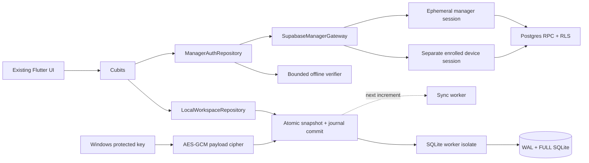

# NewCare implementation ledger

This is the implementation status, not a claim that the complete integration is
production ready. The approved business/database plan remains the wider scope.

## Current decisions from the user

- Windows desktop is the production target. Preserve the existing operational UI.
- Supabase Free only; no Edge Functions and no service-role key in Flutter.
- Managers have username/password accounts. Nursing staff select their names and
  do not have individual login accounts.
- No email confirmation. Contact email is editable profile information. Supabase
  Auth uses a stable internal username address; changing contact email does not
  change login or send an email. Password recovery by email is consequently not
  available; an administrator recovery procedure is still required.
- Offline manager login is allowed after a successful online login on that PC.
  The implemented cache lasts 7 days, uses a 600,000-iteration salted
  PBKDF2-HMAC-SHA256 verifier inside encrypted storage, persists failed-attempt
  lockout and rejects clock rollback. It cannot discover remote revocation while
  disconnected. Creating accounts/changing account details requires online Auth.
- No assistant commits or pushes.

## Implemented in this increment

| Slice | Files and behavior | Evidence |
| --- | --- | --- |
| Durable native storage | `core/storage/sqlite_string_store.dart`: one SQLite worker isolate, WAL, FULL, prepared SQL, encrypted payloads | Reopen, duplicate rollback, wrong-key preservation and backup restore tests |
| Atomic local journal | `LocalWorkspaceRepository` commits snapshot and versioned changed-record journal together before publishing state | Repository retry/delta test |
| Windows protected path | `%LOCALAPPDATA%\NewCare\Data\newcare.db`; key kept through flutter_secure_storage; missing key never creates an empty replacement | Native DB tests; Windows plugin runtime verification pending toolchain |
| Preference migration | Copy/verify workspace/settings, create and verify protected backup, then remove plaintext originals; resume after interruption | Migration cleanup ordering, failed-backup retry and conflict-preservation tests |
| Backup API | SQLite `VACUUM INTO`, including pending journal; refuses overwrite | Backup reopen verifies snapshot and operation |
| Supabase identity schema | Project `gcwwtsoavmbeaclkigus`, `Mostafa` organization, Frankfurt; migration files match server versions | Applied migrations, RLS/privilege inspection, negative access SQL |
| Manager online/offline auth | Separate device and manager clients, username resolution, bounded offline verifier, no production demo-password fallback | Offline policy tests and real KDF verification |
| Account UI | First manager/device setup, username login, manager creation, own name/contact-email/password edits | Route/localization tests and live Supabase account/permission/password/profile verification |
| Locked diagnostics | Manager-only section, local table counts, pending journal count; no fabricated cloud match | Reconciliation tests compare canonical content, scope and revision |

Payload encryption is **not whole-file SQLCipher encryption**. SQLite keys,
operation IDs/actions and row counts remain metadata. Migrated plaintext preference values are removed only after a protected SQLite
backup is verified. Migration conflicts or backup failures preserve both sources
and stop startup rather than silently deleting data.

## Run modes

Normal development without defines retains the explicitly marked local preview.
Its username is `manager`; its password remains the previously configured local
password, or `newcare-demo` if none was configured.

The ignored `config/local.json` contains the NewCare public URL and publishable
key. It contains no database password or service-role key. Start cloud-auth mode:

```powershell
flutter run -d windows --dart-define-from-file=config/local.json
```

Before first setup, the NewCare Auth settings must have:

- Allow new users to sign up: on.
- Allow anonymous sign-ins: on, for the enrolled center device.
- Confirm email: off, per the user's request.

Provisioning checks the public Auth settings and refuses to sign up while email
confirmation is enabled. There are no verification emails or SMTP dependencies
in the final username-account flow. Configure any password-change notification
settings appropriately for internal Auth addresses before production use.

## Not yet implemented / not yet verified

- Operational normalized case/receipt/outgoing/handover cloud schema and RPCs.
- Actual outbox upload, acknowledgement, incremental download, conflicts and
  reconnection orchestration. The journal is durable but **is not a sync worker**.
- Live cloud manifests for the diagnostics screen. It intentionally cannot show
  `متطابقين` until these exist and the same scope/revision/content is verified.
- Native Windows UI/plugin end-to-end testing. The Auth/RPC path was tested live
  with disposable accounts; no real manager credentials have been invented.
- Automatic rotating backups, independent-drive copies, portable key recovery,
  installer/update/uninstall preservation and signed Windows distribution.
- Physical power-loss/fault-injection testing. Reopen tests are not that proof.
- Windows native build: blocked by missing Visual Studio C++ toolchain.
- Existing preview/legacy data import needs explicit validation before cloud
  upload. Demo records must never be uploaded automatically.

## Architecture of the implemented foundation



## Verification log

- Storage/outbox/backup and offline-auth policy tests passed.
- Final suite: 96 passed, opt-in live test skipped by default.
- Opt-in live Auth/RPC test passed separately; final analyze and web build passed.
- Windows build attempted and failed before compilation: no suitable Visual
  Studio toolchain installed. No Windows executable is claimed.
- Supabase negative tests: an unregistered authenticated subject cannot resolve
  usernames, create managers, enroll a device, read center/payroll rows or edit
  another profile. Positive enrolled-device/manager sessions were also exercised
  live, including device payroll isolation and unauthorized invitation denials.
- Security advisor warnings for authenticated SECURITY DEFINER RPC entry points
  are intentional: each performs identity/permission checks with an empty search
  path. [Supabase advisor explanation](https://supabase.com/docs/guides/database/database-linter?lint=0029_authenticated_security_definer_function_executable).

Sources: [Supabase Auth source](https://github.com/supabase/auth/blob/master/internal/api/signup.go),
[Supabase RLS](https://supabase.com/docs/guides/database/postgres/row-level-security),
[OWASP password storage](https://cheatsheetseries.owasp.org/cheatsheets/Password_Storage_Cheat_Sheet.html).

## Final review and fixes

A fresh read-only reviewer identified three issues. Each was addressed with a
failing regression test followed by the implementation and a passing run:

1. Plaintext legacy preferences: verified encrypted migration backup now precedes
   preference removal; failed backup/conflicting sources retain the originals.
2. Newly created/logged-in managers: authoritative identity is projected into the
   local nursing list before entry; login integration proves case attribution
   can find the manager ID without waiting for a cloud pull.
3. Interrupted first setup: cloud binding and local-readiness are separate
   persisted states; the readiness marker is written only after local staff and
   settings commit. An incomplete setup resumes after restart.

Graphify was queried as requested, but the connected account returned no
workspaces. No indexed NewCare graph is available. The Mermaid diagram above is
derived from the local implementation and is not claimed as Graphify output.

No source commits or pushes were made. Final review has no deferred minor items.

The live test also caught a default PKCE-storage assertion in ephemeral signup
clients before any real accounts were configured. Password-only clients now use
the explicit direct-token flow with no persistent privileged session. The live
test then passed for account creation, device enrollment, username login,
permission denials, contact/name/password changes and encrypted offline cache.
Its temporary accounts and center were removed through the trusted MCP channel;
a follow-up query confirmed zero test accounts and centers remaining.

Both requested Auth switches were saved after action-time confirmation and
verified through the public settings endpoint: anonymous sign-ins on, email
auto-confirm on. No email confirmation or SMTP setup is needed for this flow.

## Final verification results

| Check | Result |
| --- | --- |
| `flutter analyze` | Passed, no issues |
| `flutter test` | 96 passed; the opt-in live test skipped by default |
| Opt-in live Supabase Auth test | Passed against the real NewCare project; disposable records removed and zero remaining verified |
| `flutter build web` | Passed |
| Windows build | Attempted; blocked before compilation by missing Visual Studio C++ toolchain |
| SQLite runtime | Required WAL fix version floor enforced and verified by native storage tests |
| Late login cancellation | Regression test confirms a delayed login cannot reopen an explicitly locked manager area |

These results verify the implemented foundation. They do not claim that the
remaining operational sync worker, conflict UI or Windows distribution is done.
