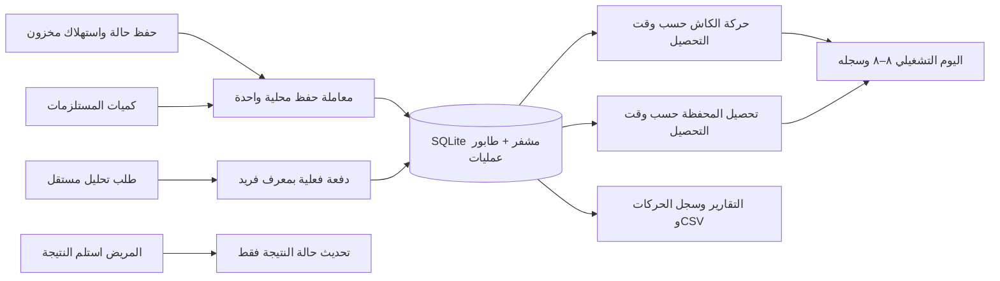

# المستلزمات والتحاليل واليوم التشغيلي — تصميم للتنفيذ

الحالة: معتمد من المستخدم بتاريخ ٣١ أكتوبر ٢٠٢٦ بعبارة «ok stsrt»، شامل عمود المستلزمات في جداول الحالات.

## المطلوب المؤكد من المستخدم

1. المدير يضيف المستلزم بالاسم والكمية فقط، والتمريض يحدد المستلزمات والكميات المستخدمة عند تسجيل الحالة، فتُخصم من المخزون.
2. المدير يضيف التحليل بالاسم والسعر. طلبات التحاليل مستقلة عن الحالات.
3. التمريض يسجل اسم المريض والسن والتحاليل المطلوبة. الدفع كامل أو جزئي أو لاحق، بكاش أو محفظة.
4. الدرج يزيد بالنقدية المحصّلة فعلًا فقط. المحفظة تظهر بقيمة منفصلة تحت قيمة الدرج.
5. اليوم التشغيلي يبدأ ٨ صباحًا بتوقيت المركز وينتهي عند ٨ صباح اليوم التالي. التصفير لعدّاد اليوم فقط، مع حفظ سجل اليوم السابق؛ ليس سحبًا تلقائيًا للأموال.
6. يمكن تسجيل عدة عمليات تسليم واستلام في اليوم نفسه، دون شيفتات.
7. حالة التحليل: قيد الانتظار / تم الاستلام. «تم الاستلام» يعني المريض استلم النتيجة.
8. كل جدول حالات، داخل المركز أو خارجه، يعرض عمود «المستلزمات المستخدمة» باسم الصنف وكميته.

## النهج المختار المقترح

ميزات `inventory` و`laboratory` مستقلة داخل نفس Flutter app، مع استخدام `WorkspaceRepository` والحفظ المشفر وطابور العمليات الموجودين. التحصيل يُضاف إلى مصدر دفعات التحاليل مرة واحدة، ثم يُشتق منه الدرج والمحفظة والتقارير.

هذا يلائم فصل التحاليل الذي طلبه المستخدم. دمج التحاليل في CaseRecord كان سيفرض ربطًا بالحالات وحقول مريض داخل نماذج الحالات، وهو خارج الطلب الحالي.

لا توجد طبقة domain أو Entities أو UseCases. تُستخدم records/models وrepositories وCubits وwidgets صغيرة. تبقى الواجهات القديمة كما هي عدا المواضع المطلوبة مباشرة.

## ١. المستلزمات

### البيانات والقواعد

- `StockItem`: معرف ثابت، اسم واحد، كمية صحيحة غير سالبة، active، version.
- `CaseStockUsage`: معرف المستلزم، الاسم وقت الاستخدام، الكمية الصحيحة الموجبة. تُضاف للقضية في حقل جديد افتراضيه قائمة فارغة.
- `StockMovement`: معرف العملية، المستلزم، التغير في الكمية، نوع التغير، وقت العملية، مرجع الحالة إن وجد، وهوية التسجيل المتاحة.
- لا يوجد سعر أو تكلفة في المستلزمات. لا تُضاف قيمتها إلى إجمالي الحالة الذي يظل يدويًا.
- أسماء المستلزمات التاريخية والأسعار القديمة في legacy SupplyItem/CaseLineItem تُحفظ للتوافق، ولا تُحوّل تلقائيًا إلى مخزون بكميات مجهولة.
- اختيار المخزون اختياري في الحالة. يمكن اختيار عدة مستلزمات مع كمية لكل واحد؛ الافتراضي ١.
- التحقق من المتاح والخصم وحفظ الحالة ودفعتها الأولى وسجل المخزون تتم في معاملة محلية واحدة، ثم نشر الحالة للواجهة بعد نجاح الحفظ.
- نقص أي صنف يرفض العملية كاملة ويحافظ على المسودة، دون خصم أصناف أخرى أو تسجيل دفعة.
- إعادة حفظ نفس الطلب بعد انقطاع الاستجابة لا تكرر الخصم أو التحصيل. لا يُخصم المخزون عند تغيير سعر الحالة فقط.
- تعديل استهلاك حالة يحسب فرق الكميات فقط. المتاح للتعديل يشمل الكمية المسجلة أصلًا على نفس الحالة. تغيير الاسم لا يغير أسماء الاستخدام التاريخية.
- أرشفة صنف تمنع استخدامه في حالة جديدة وتحفظ التاريخ. الاحتفاظ باستهلاك قديم لصنف مؤرشف أو تقليله ممكن؛ زيادته غير مسموحة.

### قرار مقترح يحتاج اعتمادًا

حذف سجل حالة لا يعيد مستلزمات مستهلكة فعليًا إلى المخزون تلقائيًا. يظهر هذا الأثر في تأكيد الحذف. لو كان الإدخال خطأ ولم تُستخدم المستلزمات، يصحح المدير الكمية من شاشة المخزون، ويُسجل التصحيح. هذه القاعدة تمنع خلق رصيد مخزون غير موجود ماديًا.

### الواجهة

- قسم «المستلزمات» في مساحة المدير: بحث، جدول اسم/متاح، وأيقونتا تعديل وأرشفة في الصف.
- الإضافة والتعديل في dialog باستخدام ManagementFormDialog؛ حقلا الاسم والكمية فقط.
- نموذج الحالة داخل/خارج المركز: محدد مستلزمات قابل للبحث، مع الكمية والمتاح لكل صنف. لا أسعار ولا إنجليزي إضافي للاسم.
- تفاصيل الحالة تعرض أسماء وكميات المستلزمات المسجلة.
- إضافة عمود «المستلزمات المستخدمة» بعد الإجراءات في جدولي داخل/خارج المركز، وفي جداول سجل الحالات الإدارية ذات الصلة، باستخدام نفس منسق البيانات.
- يعرض العمود مثل «شاش × ٢، سرنجة × ١»، بدون أسعار. إذا لم تُستخدم مستلزمات يظهر «—». الحالات القديمة التي تحتوي أسماء فقط تعرض الأسماء دون افتراض كميات لم تُسجل.
- الحفاظ على أعمدة المبالغ وطريقة الدفع والتاريخ وإجراءات الصف. يلتف نص المستلزمات داخل الخلية، مع تمرير الجدول أفقيًا عند ضيق العرض، دون قص البيانات أو خلط ألوان الأعمدة المالية بعد إضافة العمود.

## ٢. التحاليل

### القائمة والطلبات

- `LabTest`: معرف، اسم، سعر بوحدات العملة الصغيرة الصحيحة، active/version. السعر غير سالب.
- `LabOrder`: معرف ثابت، اسم المريض، السن ووحدته، التمريض المسؤول، وقت الإنشاء، عناصر التحاليل بأسعارها وأسمائها وقت التسجيل، وحالة استلام النتيجة.
- يقترح دعم اختيار أكثر من تحليل في الطلب نفسه؛ مجموع أسعار العناصر هو إجمالي الطلب. اختيار تحليل واحد يظل المسار الأبسط.
- السن قيمة صحيحة غير سالبة، بوحدة سنة افتراضيًا، مع شهر/يوم للرضع. لا تاريخ ميلاد أو عنوان أو هاتف جديد ضمن هذا الطلب.
- لا تُضاف بيانات اسم المريض والسن إلى نماذج الحالات العادية. يظلان في التحاليل المستقلة فقط.
- تغيير سعر التحليل في القائمة يطبق على الطلبات الجديدة فقط. الطلبات القديمة تحتفظ بالسعر والاسم وقت تسجيلها.
- الأسعار يُراجعها repository وقت التسجيل. تغير السعر أثناء فتح المسودة يتطلب مراجعة الإجمالي قبل الحفظ، ولا يقبل تحصيلًا أعلى منه.

### الدفعات

- `LabPayment`: معرف ثابت، مرجع الطلب، مبلغ موجب، كاش/محفظة، المحصّل، وقت التحصيل.
- دفع صفر عند التسجيل يعني عدم إنشاء إيصال أصلًا. المدفوع الكامل والجزئي يستخدمان نفس حقل «المدفوع الآن»، دون زر دفع كامل إضافي.
- كل دفعة موجبة تُحفظ في مصدر واحد. لا يُنشأ CashMovement income إضافي لنفسها.
- إجمالي المدفوع = مجموع إيصالات الطلب. المتبقي = إجمالي الطلب − المدفوع. لا قيمة سالبة أو تحصيل زائد.
- زر «تحصيل دفعة» يسجل الباقي لاحقًا أو جزءًا منه، مع طريقة الدفع لهذه الدفعة. يمكن أن يجمع الطلب دفعات كاش ومحفظة.
- الدفع الكامل أو الجزئي أو عدم الدفع لا يغير حالة استلام النتيجة.
- تصحيح دفعة من مدير يظل بآلية التعديل/التدقيق الموجودة، وبسبب واضح، ولا يسمح بتجاوز الإجمالي.

### استلام النتيجة

- `pending` = قيد الانتظار، و`received` = المريض استلم النتيجة.
- تسجيل الاستلام يحفظ وقت الاستلام ومن سجله، ولا ينشئ إيصالًا ولا يغير الدرج أو المحفظة.
- يمكن تسجيل الاستلام مع وجود مبلغ متبقٍ؛ المستخدم سمح بالدفع لاحقًا.
- منع النقر المكرر: تسجيل الاستلام مرتين لا ينشئ حدثين ولا يغير وقت الاستلام الأصلي.
- تصحيح تسجيل استلام بالخطأ يكون من مدير مع سبب وتدقيق، مع الاحتفاظ بأثر التغيير.
- لا رفع ملفات نتائج، أو إدخال نتائج طبية، أو حالة جاهز إضافية ضمن هذه الإضافة.

### الواجهة

- التمريض: صفحة «التحاليل» مستقلة، زر طلب تحليل، بحث، جدول طلبات وتحصيل دفعات وتسجيل استلام النتيجة.
- نموذج الطلب: اسم المريض، السن، التمريض المسؤول، اختيار التحاليل، الإجمالي، المدفوع الآن، المتبقي، كاش/محفظة.
- الجدول: المريض/السن، التحاليل، الإجمالي، المدفوع، المتبقي، حالة الدفع، حالة النتيجة، تاريخ/وقت التسجيل، والإجراءات المناسبة.
- المدير: نفس سجل الطلبات مع إدارة قائمة أسماء وأسعار التحاليل في تبويب مستقل داخل صفحة «التحاليل» الإدارية.
- إخفاء إدارة القائمة والتصحيحات الإدارية من واجهة التمريض؛ استخدام حساب الجهاز المعتمد دون حسابات تمريض فردية.
- الإجمالي والمدفوع والمتبقي بألوان الدلالات الحالية، مع كلمات واضحة؛ استلام النتيجة وحالة الدفع شارتان منفصلتان.

## ٣. الدرج والمحفظة واليوم التشغيلي

### حدود اليوم

- `OperationalDay` يمثل الفترة `[08:00 يوم D، 08:00 يوم D+1)` في `Africa/Cairo`.
- 07:59:59 يتبع اليوم السابق؛ 08:00:00 يتبع اليوم الجديد.
- تُحسب الحدود كتوقيت محلي في قاعدة timezone الموجودة؛ لا نضيف Duration(hours:24) لأن انتقال التوقيت الصيفي قد يغير المدة الفعلية.
- التبديل يتم أثناء تشغيل التطبيق، وعند استئنافه، وبعد فتحه إذا كان مغلقًا عند ٨. لا يحتاج إنترنت أو ضغط زر أو كتابة أرصدة صفر فوق البيانات القديمة.
- تاريخ ووقت كل عملية يبقيان محفوظين. سجل الأيام السابقة يُشتق من العمليات المحفوظة، مع أثر أي تصحيح إداري، دون حذف تاريخ مالي.

### معنيان منفصلان للنقدية

1. **صافي حركة درج اليوم**: الكاش المحصّل اليوم من الحالات والدفعات اللاحقة والتحاليل، مضافًا إليه النقدية الداخلة والتسويات الفعلية، ناقصًا منه الخوارج النقدية لهذا اليوم. هذا هو العداد الذي يبدأ من صفر.
2. **العهدة النقدية الفعلية المتوقعة**: الرصيد المادي المرحّل الموجود قبل ٨ مع كل التغيرات اللاحقة. لا يختفي عند التصفير، وهو مرجع عد النقدية عند التسليم والاستلام.

إذا كان رصيد العهدة القديم ١٠٠٠ وصُرف ٥٠ بعد ٨، فحركة اليوم = −٥٠، والعهدة المتوقعة = ٩٥٠. عدم الفصل بينهما سيُنتج عجزًا وهميًا عند العد.

- بطاقة الدرج تعرض صافي حركة اليوم، وتحتها **تحصيل المحفظة اليوم** كما طلب المستخدم.
- المحفظة = إيصالات الحالات والتحاليل بالمحفظة في اليوم التشغيلي، ولا تضم مبالغ غير محصلة ولا تدخل النقدية المتوقعة للتسليم.
- توضح شاشة العد أنها تقارن مع العهدة الفعلية المتوقعة، وليس صافي حركة اليوم. يمكن إظهار العهدة المرحّلة بتوضيح صغير عند الحاجة لتمييز الرقمين.
- عند ٨ يتغير نطاق العدّاد فقط. لا نسجل حركة سحب أو تسليم للمدير لم تحدث.
- فاتورة قديمة تم تحصيلها اليوم تدخل يوم التحصيل الفعلي، وليس يوم إنشاء الطلب.
- سجل المدير يتيح اختيار اليوم ورؤية النقدية والمحفظة والتسليمات الخاصة به. يحتفظ التمريض بالسجل التشغيلي اللازم للتسليم دون كشف إحصائيات المدير الأخرى.
- تسليم واستلام الدرج عملية عهدة، وليست إيرادًا أو مصروفًا؛ فقط فرق العد يؤثر كتسوية موثقة مرة واحدة. عدة تسليمات في اليوم مسموحة.
- قاعدة استبعاد نفس الشخص من المسلم/المستلم، والتحقق من الرصيد المتغير أثناء فتح dialog، تبقى قائمة.
- لا تغيير خفي لمعنى فلاتر التواريخ العامة: شاشة الدرج وسجل أيامه يستخدمان ٨–٨ صراحة، وفلاتر التسجيل التاريخية الأخرى تحتفظ بعناوينها وتواريخها. أي تقرير يوم تشغيلي جديد يُسمى كذلك ويستخدم نفس الحدود.

## ٤. الدرج والتقارير والحفظ المحلي

- تمديد WorkspaceSnapshot بقوائم افتراضية فارغة للمخزون وحركاته والتحاليل وطلباتها ودفعاتها؛ قراءة البيانات القديمة لا تخصم مخزونًا بأثر رجعي.
- تظل الأرقام المالية وحدات صحيحة صغيرة. الكميات منفصلة كأعداد صحيحة، ولا تُحوّل إلى مبالغ.
- إضافة LabPayment إلى TransactionEntry وReportSummary والرسوم والتصدير ذات الصلة، بالاعتماد على وقت إيصال الدفع ومصدره، مرة واحدة.
- الإحصائيات الخاصة بالحالات والإجراءات لا تُسمّي طلبات التحاليل حالات تمريض ولا تخلطها بإيراد إجراء بعينه.
- إعادة التشغيل بعد نجاح الحفظ تستعيد الطلب والمخزون والدفعات وحالات الاستلام وسجلات العهدة كما كانت.
- فشل الحفظ لا يعلن نجاحًا ولا ينشر رصيدًا أو كمية جديدة في الواجهة.

### حد التكامل الحالي

الحفظ المشفر وطابور العمليات موجودان. مزامنة الحالات والخوارج الفعلية مع Supabase ما زالت غير مفعلة في هذا الفرع. هذه الإضافة تُنفذ بقواعد عمل كاملة محليًا وتدخل طابور العمليات والتشخيص، مع تحديث تصميم جداول/RPC المخزون والتحاليل ضمن خطة التكامل. لا يُدعى أن المخزون متزامن بين أجهزة متعددة أو أن السحابة متطابقة حتى يعمل مسار المزامنة واختبار التعارضات فعلًا.

لا Edge Functions، ولا مفاتيح service-role داخل Flutter، ولا ترقية مدفوعة، ولا commits أو push من المساعد.

## ٥. ملكية المكونات والملفات

| الدور | المالك المستخدم/الممتد |
| --- | --- |
| الهيكل والتنقل | WorkspaceShell، AppPage، قوائم المدير/التمريض الموجودة |
| الألوان والخط | AppColors وAppTheme وCairo المحلي، بدون إعادة تصميم |
| الجداول والأفعال | NcAdaptiveTable وNcActionRow وأيقونات صفية مباشرة |
| الحقول والاختيار | NcField/NcSelect وCatalogueMultiPicker الممتد باحتياج كميات المخزون |
| حوارات المدير | ManagementFormDialog، ونفس سلوك حفظ/إلغاء/رسالة خطأ |
| عمليات الحفظ | ActionCubit وOperationError وNcButton.busy |
| قراءة البيانات | WorkspaceCubit وWorkspaceRepository وLocalWorkspaceRepository |
| الوقت | CenterClock مع OperationalDay وموفر وقت قابل للاختبار |
| التحصيل | مصدر LabPayment مستقل؛ إسقاط موحد داخل حركات الدرج والتقارير |
| اللغة | ARB عربي/إنجليزي، Cairo، اتجاه RTL/LTR، Money/formatters الموجودة |

الميزات الجديدة توضع تحت `features/inventory` و`features/laboratory` بقسمي data وpresentation. helpers اليوم التشغيلي تحت core/utils أو drawer/data وفق مسؤوليتها. توثيق DESIGN.md وUX-CONTRACT.md سيصف هوية المشروع الحالية وسلوك هذه الإضافات فقط.

## ٦. الاختبارات ومعايير القبول

1. إضافة صنف بكمية ١٠، ثم حالة تستهلك ٢، فتظهر ٨ في المخزون وتُحفظ الكمية المستخدمة في الحالة.
2. تكرار نفس طلب الحفظ لا يخصم مرة ثانية؛ تغيير سعر الحالة فقط لا يغير المخزون.
3. نقص صنف واحد يرفض الحفظ بالكامل ويحافظ على كل الكميات والدفعات كما كانت.
4. تعديل كمية استهلاك الحالة يحسب الفرق، مع السماح بالاحتفاظ باستهلاكها السابق عندما يصبح المتاح صفرًا.
5. قراءة البيانات القديمة لا تنشئ كميات أو حركات استهلاك وهمية.
6. طلب تحليل ٣٠٠ بلا دفع: متبقي ٣٠٠، الدرج والمحفظة بلا زيادة.
7. تحصيل ١٠٠ كاش ثم ٢٠٠ محفظة: النقدية تزيد ١٠٠، المحفظة ٢٠٠، المتبقي صفر، دون حركات دخل مكررة.
8. تغيير سعر القائمة لا يغير فاتورة طلب قديم أو إيصالاته.
9. تكرار إيصال أو النقر على تسجيل الاستلام مرتين لا يكرر أثرًا.
10. الاستلام مع دين متبقٍ مسموح، ولا يعتبر دفعة؛ دفع كامل لا يعتبر استلام نتيجة.
11. تحصيل فاتورة قديمة بعد ٨ يضاف إلى يوم التحصيل، وليس يوم إنشاء الفاتورة.
12. اختبار 07:59:59 و08:00:00، وأيام تغيير التوقيت الصيفي، وإغلاق/فتح التطبيق بعد الحدود.
13. عدة تسليمات في اليوم نفسه، مع حفظ كل العدّات والأشخاص والفروق وحالة متطابق/عجز/زيادة.
14. تصفير عداد اليوم لا يمحو عمليات أو يختلق مصروفًا ولا يغير العهدة المرحّلة.
15. المحفظة لا تدخل expected cash في حوار التسليم؛ التغييرات النقدية أثناء فتح العد تجعل التأكيد بحاجة للمراجعة.
16. التقارير والرسوم وCSV تشمل دفعات التحاليل مرة واحدة، وتحتفظ بدلالة مصادرها.
17. اختبار فشل تخزين ثم إعادة المحاولة، وإعادة فتح SQLite مع طلبات ومخزون ودفعات محفوظة.
18. إدارة المخزون والأسعار والتصحيحات محجوبة عن التمريض؛ لا حسابات تمريض جديدة.
19. كل الكلمات الجديدة مترجمة، وكل الشاشات تعمل بالموبايل والتابلت والسطح المربع والسطح العريض، دون فقد المسودات.
20. `flutter analyze`، اختبارات المشروع، و`flutter build web`، وفحص بصري للشاشات الجديدة. Windows native build يبقى معتمدًا على اكتمال إصلاح Windows Installer/C++ toolchain.
21. التحقق من عمود المستلزمات في جداول الداخل والخارج وسجل المدير، وعرض الكميات والأسماء القديمة والحالة الفارغة، مع بقاء ألوان ومحتوى الإجمالي والمدفوع والمتبقي وطريقة الدفع والتاريخ صحيحة.

## قرارات تنفيذية مقترحة للاعتماد

- كميات صحيحة، بلا سعر للمستلزمات؛ تغيير كمية المدير تصحيح مدقق للمتاح.
- حذف الحالة لا يعيد المخزون تلقائيًا، وتصحيح الإدخال الخاطئ متاح للمدير.
- الطلب يدعم تحليلًا واحدًا أو عدة تحاليل، بأسعار محفوظة وقت التسجيل.
- السن يدعم سنة/شهر/يوم. استلام النتيجة مستقل عن الدفع، وتصحيحه من مدير مع تدقيق.
- عداد اليوم والعهدة الفعلية شيئان منفصلان كما هو موضح بالمثال، دون إعادة إدخال الشيفتات.
- التنفيذ المحلي يشمل قواعد العمل والحفظ والواجهة والتقارير؛ تظل حدود المزامنة الحالية معلنة.
